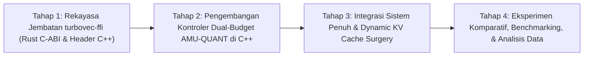
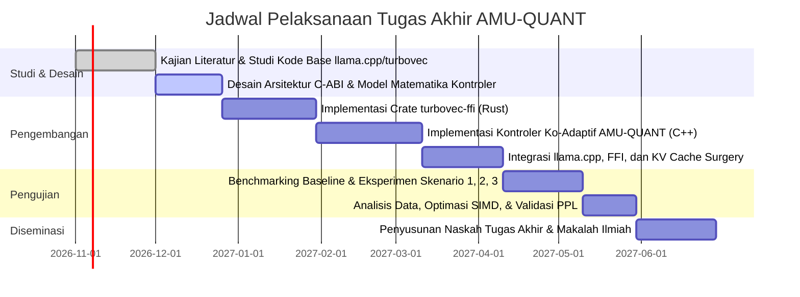

# USULAN TUGAS AKHIR

**Judul Tugas Akhir:**  
**Perancangan dan Evaluasi AMU-QUANT: Algoritma Ko-Adaptasi Layer-wise Weight Streaming dan Kompresi Konteks TurboQuant Menggunakan Pustaka turbovec pada Inferensi Large Language Model Skala Besar di Perangkat Bermemori Terbatas**

**Bidang Minat:** Rekayasa Perangkat Lunak Berperforma Tinggi (*High-Performance Systems for AI*) & Komputasi Cerdas  
**Tahun Ajaran:** 2026/2027  

---

## ABSTRAK

Menjalankan model bahasa berskala besar (*Large Language Model* / LLM) dengan kapasitas 14 miliar hingga 32 miliar parameter secara lokal pada perangkat komputasi personal dengan kapasitas RAM terbatas (8 GB–16 GB) menghadapi batas fisik berupa perebutan memori (*memory contention*) antara bobot statis model (*model weights*) dan memori dinamis konteks (*Key-Value Cache* / KV-Cache). Pendekatan *layer-wise streaming* konvensional seperti AirLLM atau *memory-mapped I/O* (`mmap`) pada `llama.cpp` hanya berfokus pada pengalihan bobot model dari SSD ke RAM per layer, namun membiarkan KV-Cache tetap membengkak di RAM fisik seiring bertambahnya token. Akibatnya, alokasi *page cache* sistem operasi terdesak, memicu *major page fault*, *swap thrashing*, dan kegagalan *Out-of-Memory* (OOM) *Killer*. Di sisi lain, metode pemangkasan konteks modern (StreamingLLM, H2O, ThinKV, Lethe) membuang token lama secara permanen (*evict-to-trash*) dan sepenuhnya buta terhadap telemetri memori sistem operasi.

Penelitian ini mengusulkan **AMU-QUANT**, sebuah arsitektur inferensi LLM native berbasis C++17 dan Rust yang mengintegrasikan algoritma penjadwal memori ko-adaptif (*dual-budget co-adaptive controller*) dengan pustaka kompresi vektor berkecepatan tinggi `turbovec` (implementasi algoritma Google Research TurboQuant ICLR 2026). Melalui jembatan *Foreign Function Interface* (C-ABI `turbovec-ffi`), blok token yang dipangkas dari KV-Cache `llama.cpp` diarsipkan ke dalam memori vektor terkompresi 4-bit atau 2-bit (*evict-to-index*) tanpa penyalinan data perantara (*zero-copy*). Penghematan memori KV-Cache (mencapai 7,8x hingga 15,5x) dialokasikan secara dinamis oleh AMU-QUANT untuk memperluas jendela *prefetching* bobot model pada `mmap` menggunakan panggilan kernel `posix_madvise(..., POSIX_MADV_DONTNEED / WILLNEED)`. Evaluasi komparatif akan dilakukan pada model kelas 8B, 14B, dan 32B (arsitektur Qwen-2.5 dan Llama-3 dalam kuantisasi Q4_K_M) pada batasan RAM 8 GB dan 16 GB. Hasil yang diharapkan mencakup kelulusan inferensi 100% (*zero OOM crash*), pengurangan *page faults* hingga >85%, waktu pencarian kembali konteks SIMD <0,25 ms, dan pelestarian akurasi konteks pada pengujian *Needle-in-a-Haystack* konteks panjang.

**Kata Kunci:** *Large Language Model (LLM)*, *Layer-wise Weight Streaming*, *Key-Value Cache*, *TurboQuant*, *turbovec*, *Memory Pressure*, *llama.cpp*, *Foreign Function Interface (FFI)*, *Co-Adaptive Memory Management*.

---

## BAB I: PENDAHULUAN

### 1.1 Latar Belakang Masalah
Kemajuan mutakhir kecerdasan artifisial generatif telah menempatkan *Large Language Models* (LLMs) dengan kapasitas 14 miliar (14B) hingga 32 miliar (32B) parameter—seperti seri Llama-3, Qwen-2.5, dan model penalaran DeepSeek-R1-Distill—sebagai standar emas untuk tugas-tugas penalaran (*reasoning*), pemrograman (*code generation*), dan sintesis dokumen komprehensif. Menjalankan model-model ini secara lokal pada perangkat pengguna (*on-device inference*) menawarkan keunggulan krusial dalam hal privasi data, ketiadaan latensi jaringan, serta independensi dari biaya API komersial berbasis *cloud*.

Namun, implementasi lokal pada komputer jinjing (*laptop*) atau *workstation* kelas konsumen yang umumnya hanya dibekali memori fisik (RAM) sebesar 8 GB hingga 16 GB terbentur pada keterbatasan fisik alokasi memori *Resident Set Size* (RSS). Kebutuhan memori inferensi LLM berasal dari dua komponen utama:

1. **Memori Bobot Statis (*Static Model Weights*):** Model 32B yang dikuantisasi ke format 4-bit (misalnya GGUF Q4_K_M) masih membutuhkan ruang penyimpanan memori sebesar $\approx 19{,}5\text{ GB}$. Ukuran ini sudah melampaui seluruh kapasitas RAM fisik perangkat 16 GB, apalagi perangkat 8 GB.
2. **Memori Konteks Dinamis (*Dynamic KV-Cache*):** Selama fase pembuatan token berulang (*autoregressive decoding*), *Key-Value Cache* (KV-Cache) dari modul *multi-head attention* bertambah secara linier proporsional terhadap panjang konteks ($T$). Pada model 32B dengan $L=64$ layer, dimensi tersembunyi $d=5120$, dan presisi FP16, KV-cache mengonsumsi sekitar $1{,}3\text{ MB}$ per token. Pada konteks sepanjang $8192$ token, KV-Cache sendiri menghabiskan $\approx 10{,}5\text{ GB}$ RAM fisik.

Hingga saat ini, belum ada arsitektur inferensi yang mampu mengelola interaksi mutualistis antara kedua komponen memori ini di bawah tekanan memori sistem operasi (*OS memory pressure*). Pendekatan yang ada terpecah ke dalam dua kubu yang saling terisolasi:

* **Kelemahan Pendekatan *Layer-wise Streaming* Murni:**  
  Proyek seperti AirLLM ([Lyogavin, 2023/2024](https://github.com/lyogavin/airllm)) dan fitur *Memory-Mapped I/O* (`mmap`) pada `llama.cpp` ([Gerganov et al., 2026](https://github.com/ggml-org/llama.cpp)) mengalirkan bobot layer per layer dari *Solid State Drive* (SSD) ke RAM saat komputasi berlangsung. Namun, pendekatan ini memiliki titik buta kritis: KV-cache untuk seluruh layer harus tetap berada di dalam RAM fisik. Ketika konteks bertambah panjang, KV-Cache merebut ruang memori fisik yang dialokasikan sistem operasi untuk *page cache buffer*. Akibatnya, kernel OS terpaksa melakukan pelepasan halaman aktif secara agresif, menimbulkan lonjakan *major page faults*, kemacetan I/O (*swap thrashing*), penurunan throughput hingga di bawah $0{,}1\text{ token/detik}$, dan berakhir pada terminasi paksa oleh mekanisme *Out-of-Memory* (OOM) *Killer*.

* **Kelemahan Pendekatan Pemangkasan Konteks Konvensional:**  
  Metode pemangkasan KV-cache seperti StreamingLLM ([Xiao et al., ICLR 2024](https://arxiv.org/abs/2309.17453)), H2O ([Zhang et al., NeurIPS 2023](https://arxiv.org/abs/2306.14048)), ThinKV ([ICLR 2026](https://arxiv.org/abs/2510.01290)), dan Lethe ([AAAI 2026](https://arxiv.org/abs/2511.12612)) membuang token yang dianggap tidak relevan secara permanen ke tempat sampah (*evict-to-trash*). Hal ini menyebabkan model mengalami *permanent context loss*, ketidakmampuan mengingat instruksi terdahulu (*Needle-in-a-Haystack degradation*), serta tidak adanya integrasi dengan telemetri memori OS (pemangkasan dilakukan berdasarkan heuristik token statis, bukan tekanan RAM dinamis).

* **Peluang Integrasi Kompresi Vektor TurboQuant dan `turbovec`:**  
  Terobosan baru dari Google Research, yaitu TurboQuant ([Zandieh et al., ICLR 2026](https://arxiv.org/abs/2504.19874)), memperkenalkan kuantisasi vektor daring tanpa pelatihan (*zero-training online vector quantization*) menggunakan rotasi ortogonal acak dan kuantisasi skalar Lloyd-Max. TurboQuant mencapai rasio kompresi dramatis sebesar 7,8x pada presisi 4-bit dan 15,5x pada presisi 2-bit dengan distorsi teoritis mendekati batas optimal Shannon. Implementasi mutakhir TurboQuant dalam bahasa pemrograman Rust performa tinggi, yaitu `turbovec` ([Codrai, 2026](https://github.com/RyanCodrai/turbovec)), membuktikan kemampuan kompresi vektor dalam hitungan mikrodetik serta kecepatan pencarian kemiripan kosinus berbasis SIMD di bawah $0{,}25\text{ milidetik}$.

Meskipun demikian, saat ini `turbovec` hanya berdiri sebagai *vector search database* mandiri, belum memiliki jembatan *Foreign Function Interface* (C-ABI FFI), dan belum pernah diintegrasikan sebagai *episodic memory buffer* interaktif di dalam *engine* inferensi C++ seperti `llama.cpp`.

Berdasarkan kesenjangan tersebut, penelitian ini mengusulkan perancangan dan evaluasi **AMU-QUANT**, sebuah algoritma pengontrol ko-adaptif (*co-adaptive memory controller*) yang menghubungkan alokasi buffer streaming bobot model per-layer dengan kompresi konteks *in-memory* berbasis `turbovec`. Dengan memonitor telemetri kernel sistem operasi secara berkala, AMU-QUANT secara adaptif menyeimbangkan kapasitas RAM fisik antara jendela *prefetching* bobot dan kuota KV-cache melalui mekanisme *evict-to-index*, memungkinkan eksekusi model 14B–32B pada perangkat RAM 8 GB–16 GB secara stabil dan berkinerja tinggi.

---

### 1.2 Identifikasi Masalah
Berdasarkan latar belakang di atas, dapat diidentifikasi beberapa permasalahan mendasar:
1. **Konflik Alokasi Memori Bersaing:** Terjadi perebutan kapasitas RAM fisik antara *page cache* kernel (yang dibutuhkan untuk membaca file model berukuran 19,5 GB dari SSD secara cepat) dan struktur KV-Cache yang membengkak seiring bertambahnya panjang konteks generasi.
2. **Ketiadaan Sinergi Antara Weight Streaming dan KV-Cache:** Sistem inferensi modern menangani bobot dan KV-cache sebagai dua subsistem yang terpisah tanpa umpan balik (*closed-loop feedback*) terhadap tekanan memori sistem operasi.
3. **Kehilangan Informasi Akibat Eviction Naif:** Metode pemangkasan KV-cache yang ada saat ini membuang token lama secara permanen, sehingga informasi penting pada percakapan atau dokumen panjang hilang.
4. **Hambatan Interoperabilitas Bahasa Komputasi:** Pustaka vektor mutakhir `turbovec` ditulis dalam Rust tanpa antarmuka C-ABI yang kompatibel dengan ekosistem `llama.cpp` (C/C++), menghalangi pertukaran tensor pointer secara *zero-copy*.

---

### 1.3 Rumusan Masalah
Penelitian ini dirumuskan ke dalam empat pertanyaan penelitian (*research questions*):
1. **RQ1:** Bagaimana karakteristik interaksi perebutan memori (*memory contention*) antara OS *page cache* untuk *layer-wise weight streaming* (`mmap`) dan pertumbuhan KV-Cache memengaruhi metrik *inter-token latency*, laju *major page faults*, dan probabilitas kegagalan OOM pada eksekusi model 14B–32B di perangkat RAM 8 GB–16 GB?
2. **RQ2:** Bagaimana merancang arsitektur jembatan *Foreign Function Interface* (C-ABI `turbovec-ffi`) antara C++ (`llama.cpp`) dan Rust (`turbovec`) agar proses pemindahan blok konteks (*zero-copy pointer passing*) dan pencarian kemiripan kosinus berbasis instruksi SIMD dapat berjalan dengan *overhead* latensi di bawah $1\text{ ms}$?
3. **RQ3:** Bagaimana memodelkan dan mengimplementasikan algoritma pengontrol ko-adaptif (*AMU-QUANT Scheduler*) yang secara simultan mengatur jendela residensi layer bobot di RAM (melalui instruksi kernel `madvise` / `VirtualUnlock`) dan tingkat kompresi konteks di `turbovec` (KV penuh $\to$ 4-bit $\to$ 2-bit) berdasarkan estimasi laju perubahan tekanan memori OS?
4. **RQ4:** Seberapa besar peningkatan tingkat keberhasilan inferensi (*survival rate*), throughput token, penghematan konsumsi RAM fisik, serta pelestarian akurasi pengambilan konteks (*retrieval accuracy*) yang dicapai oleh AMU-QUANT dibandingkan dengan `llama.cpp` standar, *layer-streaming* murni, dan metode pemangkasan KV-cache naif?

---

### 1.4 Batasan Masalah dan Asumsi Teknis
Agar penelitian tetap terfokus dan dapat dieksekusi secara terukur, ditetapkan batasan-batasan teknis berikut:
1. **Format Model & Kuantisasi:** Model yang diuji berada dalam format GGUF dengan skema kuantisasi bobot Q4_K_M (4-bit medium quantization). Model uji mencakup kelas 8B, 14B, dan 32B (arsitektur Llama-3, Qwen-2.5, dan DeepSeek-R1-Distill-Qwen).
2. **Lingkungan Pemrograman:** Komponen sistem dibangun secara *native* menggunakan C++17 (memanfaatkan API pustaka `llama.cpp`) dan Rust (menggunakan `turbovec`), tanpa melibatkan *runtime* Python pada tahap inferensi eksekusi.
3. **Panggilan Sistem Operasi:** Pengendalian memori halaman virtual berbasis kernel POSIX (`posix_madvise`, `vm_stat` / `/proc/meminfo`). Adaptasi Windows menggunakan API `VirtualUnlock` dan `PrefetchVirtualMemory`.
4. **Batasan Komputasi Rendah (*Non-Goals*):** Penelitian ini tidak memodifikasi kernel perkalian matriks tingkat rendah di dalam mesin komputasi `ggml` dan tidak melakukan pelatihan ulang (*fine-tuning*) terhadap parameter bobot LLM.

---

### 1.5 Tujuan Penelitian
Tujuan dari pelaksanaan penelitian tugas akhir ini adalah:
1. **Tujuan Teoretis & Eksploratif:** Memetakan dan mengukur secara empiris dinamika *bottleneck* I/O penyimpanan dan *memory thrashing* saat menjalankan model dengan ukuran bobot melampaui kapasitas RAM fisik di bawah variasi panjang konteks.
2. **Tujuan Rekayasa Sistem (FFI):** Membangun pustaka sistem terbuka `turbovec-ffi` yang menyediakan antarmuka C-ABI aman (*thread-safe* dan *panic-safe*) untuk memfasilitasi pengiriman pointer tensor C++ ke modul kompresi vektor SIMD Rust secara *zero-copy*.
3. **Tujuan Algoritmik:** Merancang dan mengimplementasikan algoritma pengontrol memori ganda (*dual-budget co-adaptive scheduler*) AMU-QUANT yang secara otomatis mengatur rejim residensi bobot dan kompresi memori konteks berdasarkan estimasi tekanan memori prediktif $\Phi_t$.
4. **Tujuan Evaluatif:** Membuktikan keandalan AMU-QUANT dalam mencapai kelulusan eksekusi 100% (*zero OOM*) pada perangkat RAM 8 GB dan 16 GB, meminimalkan latensi *inter-token*, dan mempertahankan ketahanan akurasi konteks pada evaluasi *Needle-in-a-Haystack*.

---

### 1.6 Manfaat Penelitian
* **Manfaat Teoretis:** Memberikan kontribusi ilmiah berupa formalisasi matematika model ekuilibrium dinamis antara *weight caching* dan *episodic context compression* pada arsitektur perangkat keras berdaya terbatas.
* **Manfaat Rekayasa Perangkat Lunak:** Menyediakan modul *open-source* berstandar C-ABI (`turbovec-ffi`) yang menjembatani inovasi algoritma kuantisasi TurboQuant di ekosistem Rust dengan komunitas C/C++ `llama.cpp`.
* **Manfaat Praktis & Sosial:** Mendemokratisasi akses LLM mutakhir berkapasitas 14B–32B agar dapat berjalan secara lokal pada komputer jinjing mahasiswa, peneliti, dan praktisi tanpa memerlukan GPU mahal atau infrastruktur server komersial.

---

## BAB II: TINJAUAN PUSTAKA & MATRIKS KEBARUAN

### 2.1 Kajian Pustaka Terkait

#### A. Layer-wise LLM Weight Streaming (Model > RAM)
* **AirLLM ([Lyogavin, 2023/2024](https://github.com/lyogavin/airllm)):** Mempelopori eksekusi model 70B pada GPU 4 GB dengan cara membagi bobot model menjadi file per-layer di disk dan memuatnya secara sekuensial ke VRAM. Meskipun membuktikan kelayakan komputasi layer-wise, AirLLM ditulis dalam Python, membutuhkan proses *splitting* file model yang memakan waktu dan ruang disk ganda, serta memiliki latensi antartoken yang sangat lambat (mencapai puluhan detik per token).
* **llama.cpp mmap ([Gerganov et al., 2026](https://github.com/ggml-org/llama.cpp)):** Menggunakan pemetaan file memori virtual (`mmap`) pada satu file `.gguf` utuh. Fitur ini memungkinkan kernel OS memuat halaman memori sesuai kebutuhan (*demand paging*). Namun, `llama.cpp` tidak mengontrol pelepasan halaman secara proaktif; saat KV-cache memenuhi RAM, kernel OS mengalami kebuntuan alokasi halaman, memicu *major page fault storm* dan terminasi OOM.

#### B. Algoritma Kompresi & Pemangkasan KV-Cache
* **StreamingLLM ([Xiao et al., ICLR 2024](https://arxiv.org/abs/2309.17453)):** Menemukan fenomena *Attention Sink*, di mana token awal (token 0–3) menerima bobot perhatian yang sangat besar meskipun tidak bermakna semantik. StreamingLLM mempertahankan token awal dan jendela token terbaru (*sliding window*), membuang token di tengah secara permanen.
* **H2O ([Zhang et al., NeurIPS 2023](https://arxiv.org/abs/2306.14048)):** Mengidentifikasi *Heavy Hitter* tokens (token yang sering menerima akumulasi perhatian tinggi) dan mempertahankan subkumpulan token tersebut bersama token terbaru.
* **ThinKV ([ICLR 2026](https://arxiv.org/abs/2510.01290)) & Lethe ([AAAI 2026](https://arxiv.org/abs/2511.12612)):** Mengoptimalkan pemangkasan KV-cache secara adaptif per layer untuk model penalaran (*reasoning models*). Namun, seluruh metode ini tetap bersifat *evict-to-trash* (token terhapus tidak dapat dipulihkan kembali) serta tidak memiliki kesadaran terhadap ketersediaan RAM fisik sistem.

#### C. TurboQuant dan Pustaka Indeks Vektor turbovec
* **TurboQuant ([Zandieh et al., ICLR 2026](https://arxiv.org/abs/2504.19874)):** Mengatasi kelemahan *Product Quantization* (PQ) konvensional yang memerlukan pelatihan *codebook* K-Means yang lambat. TurboQuant menerapkan rotasi ortogonal acak pada vektor representasi, mengubah distribusi data menjadi distribusi Gaussian multivariat standar, kemudian melakukan kuantisasi skalar Lloyd-Max optimal 4-bit dan 2-bit.
* **turbovec ([Codrai, 2026](https://github.com/RyanCodrai/turbovec)):** Pustaka Rust yang mengimplementasikan TurboQuant dengan akselerasi instruksi vektor SIMD (AVX-512 / AVX2 / ARM NEON). Pengujian menunjukkan waktu indeks mikrodetik, kompresi 7,8x (4-bit) dan 15,5x (2-bit), serta latensi pencarian di bawah $0{,}25\text{ ms}$.

---

### 2.2 Matriks Posisi Kebaruan (Novelty Matrix)

Tabel berikut menegaskan posisi kebaruan AMU-QUANT terhadap penelitian dan perangkat lunak *state-of-the-art*:

| Metode / Proyek | Referensi & Bahasa | Layer Streaming (Model > RAM) | Kompresi Konteks TurboQuant | Kesadaran Tekanan Memori OS | Mekanisme Evict-to-Index & SIMD Recall | Overhead Runtime Python |
|:---|:---|:---:|:---:|:---:|:---:|:---:|
| **AirLLM** | [Lyogavin (2024)](https://github.com/lyogavin/airllm) (Python) | Ya (File Splitting) | Tidak | Tidak | Tidak | Ya (Tinggi) |
| **StreamingLLM** | [ICLR 2024](https://arxiv.org/abs/2309.17453) (Python) | Tidak | Tidak | Tidak | Tidak (Permanen Dihapus) | Ya |
| **H2O** | [NeurIPS 2023](https://arxiv.org/abs/2306.14048) (Python) | Tidak | Tidak | Tidak | Tidak (Permanen Dihapus) | Ya |
| **ThinKV / Lethe** | [ICLR/AAAI 2026](https://arxiv.org/abs/2510.01290) (Python) | Tidak | Tidak | Tidak | Tidak (Permanen Dihapus) | Ya |
| **llama.cpp (mmap)** | [Gerganov (2026)](https://github.com/ggml-org/llama.cpp) (C++) | Pasif (OS Managed) | Tidak | Tidak | Tidak | Ketiadaan Python |
| **TurboQuant Fork** | [TheTom/AmesianX (2026)](https://github.com/TheTom/llama-cpp-turboquant) (C++) | Tidak | Ya (Statis KV-Cache) | Tidak | Tidak | Ketiadaan Python |
| **turbovec** | [RyanCodrai (2026)](https://github.com/RyanCodrai/turbovec) (Rust) | Tidak | Ya (4-bit & 2-bit) | Tidak | Ya (Khusus Vektor DB RAG) | Ketiadaan Python |
| **AMU-QUANT** *(Usulan TA Ini)* | **Tugas Akhir (2026)** (C++ & Rust FFI) | **Ya (Aktif madvise / Prefetch)** | **Ya (Dinamis Mid-Gen)** | **Ya (Dual-Budget Controller)** | **Ya (turbovec SIMD Recall <0.25ms)** | **Ketiadaan Python (Native)** |

---

## BAB III: METODOLOGI PENELITIAN

### 3.1 Tahapan Pelaksanaan Penelitian
Penelitian ini dijalankan melalui 4 tahapan sistematis:

#### Tahap 1: Pengembangan Modul Jembatan C-ABI `turbovec-ffi`
* Mengembangkan modul Rust `ffi.rs` di atas `turbovec` yang mengekspos antarmuka C-ABI yang kompatibel dengan C++17.
* Mengimplementasikan manajemen alokasi indeks (`turbovec_init`, `turbovec_free`), penyisipan tensor langsung (*zero-copy raw pointer passing*) tanpa duplikasi memori (`turbovec_insert_zero_copy`), kuantisasi ulang *in-place* dari 4-bit ke 2-bit (`turbovec_requantize_to_2bit`), serta pencarian kemiripan kosinus SIMD berkecepatan tinggi (`turbovec_search_simd`).
* Menyediakan penanganan kesalahan (*error handling*) berbasis kode status C dan *panic catch boundary* (`std::panic::catch_unwind`) di sisi Rust untuk mencegah *undefined behavior* saat terjadi pengecualian.

#### Tahap 2: Perumusan & Pemodelan Algoritma Kontroler AMU-QUANT
* Memodelkan persamaan ekuilibrium alokasi memori sistem ganda:
  $$M_{\text{ext}}(t) + \sum_{l \in \mathcal{L}_{\text{resident}}(t)} M_{\text{weight}}(l) + M_{\text{KV}}(W_t) + M_{\text{turbovec}}(C_t, b_t) \le M_{\text{limit}}$$
* Merumuskan fungsi penentu Skor Tekanan Memori Prediktif ($\Phi_t$) yang menggabungkan rasio utilitas memori absolut dan laju pertumbuhan memori diferensial:
  $$\Phi_t = \alpha \left( \frac{M_{\text{total}}(t)}{M_{\text{limit}}} \right) + \beta \left( \frac{\widehat{\Delta M}_t}{\Delta t} \cdot \tau_{\text{horizon}} \right)$$
* Menyusun mesin keadaan (*state machine*) pengendali 3 rejim dengan *hysteresis buffer* guna mencegah osilasi pelepasan/pemuatan halaman (*thrashing*).

#### Tahap 3: Integrasi dengan Mesin Inferensi `llama.cpp`
* Mengimplementasikan pengendali pelepasan halaman memori model (`madvise` dengan flag `POSIX_MADV_DONTNEED`) pada tensor layer yang tidak sedang aktif, serta memberikan sinyal *prefetching* (`POSIX_MADV_WILLNEED`) untuk layer berikutnya pada pipeline komputasi.
* Mengintegrasikan pemangkasan KV-cache menggunakan API resmi `include/llama.h`, yaitu `llama_kv_cache_seq_rm()` untuk menghapus token non-kritis dan `llama_kv_cache_seq_add()` untuk menggeser indeks posisi Rotary Position Embedding (RoPE).
* Menghubungkan tensor representasi token yang dipangkas ke dalam indeks `turbovec` secara *in-memory*.

#### Tahap 4: Pengujian, Benchmarking, dan Analisis
* Menjalankan eksperimen komparatif komprehensif pada perangkat uji fisik.
* Menganalisis metrik performa, latensi, penggunaan memori, dan ketahanan konteks.

---

### 3.2 Spesifikasi Model & Lingkungan Eksperimen

#### A. Konfigurasi Perangkat Keras Uji
1. **Node Uji A (RAM 16 GB):** Apple Silicon Mac (M-Series / Unified Memory 16 GB) atau Laptop x86-64 Intel/AMD RAM 16 GB DDR5, NVMe PCIe 4.0 SSD (Read speed $\ge 4500\text{ MB/s}$).
2. **Node Uji B (RAM 8 GB):** Laptop x86-64 / Mac RAM 8 GB (Kondisi memori sangat terbatas).

#### B. Model Pengujian (Format GGUF Q4_K_M)
* **Kelas 8B:** `Llama-3-8B-Instruct` ($\approx 4{,}9\text{ GB}$) sebagai baseline validasi dasar.
* **Kelas 14B:** `Qwen2.5-14B-Instruct` ($\approx 9{,}0\text{ GB}$) — Model melebihi RAM pada node 8 GB, mendekati batas pada node 16 GB.
* **Kelas 32B:** `Qwen2.5-32B-Instruct` / `DeepSeek-R1-Distill-Qwen-32B` ($\approx 19{,}5\text{ GB}$) — Model melampaui RAM pada seluruh node uji.

---

### 3.3 Skenario Pengujian

1. **Skenario 1: Skalabilitas Ukuran Model & Panjang Konteks (Clean Run)**  
   Menjalankan inferensi model 8B, 14B, dan 32B pada panjang konteks 2048 (2K), 4096 (4K), 8192 (8K), hingga 16384 (16K) token tanpa gangguan memori eksternal. Mengukur titik batas OOM pada baseline vs AMU-QUANT.
2. **Skenario 2: Dynamic OS Memory Pressure Injection (Stress Test)**  
   Menginjeksikan beban alokasi memori eksternal secara dinamis saat LLM sedang melakukan *autoregressive generation* (misalnya proses eksternal mengalokasikan 4 GB RAM secara tiba-tiba). Menguji ketangguhan rejim adaptasi AMU-QUANT dalam mencegah OOM dan menjaga stabilitas sistem operasi.
3. **Skenario 3: Evaluasi Ketahanan Konteks (Needle-in-a-Haystack)**  
   Menyisipkan fakta acak spesifik (*needle*) pada posisi kedalaman bervariasi (0%, 25%, 50%, 75%, 100%) dalam dokumen berukuran 8K dan 16K token. Menguji akurasi pemulihan informasi (*retrieval recall*) menggunakan pencarian SIMD `turbovec` dibandingkan dengan metode *evict-to-trash* (StreamingLLM/H2O).

---

### 3.4 Parameter & Metrik Evaluasi

| Kategori Evaluasi | Parameter / Metrik | Deskripsi & Formula | Alat Ukur / Metode |
|:---|:---|:---|:---|
| **Stabilitas Memori** | **Peak RSS (GB)** | Konsumsi memori fisik puncak selama inferensi | `/proc/[pid]/status` (VmHWM) / `getrusage` |
| | **Survival Rate (%)** | Persentase tugas inferensi yang tuntas tanpa terminasi OOM | $\frac{\text{Tugas Selesai}}{\text{Total Tugas}} \times 100\%$ |
| | **Rasio Kompresi Konteks** | Perbandingan ukuran memori KV asli terhadap KV terkompresi | $\frac{\text{Size}_{\text{FP16}}}{\text{Size}_{\text{turbovec}}}$ |
| **Performa Eksekusi** | **Inter-Token Latency (ITL)** | Waktu jeda antargenerasi token autoregresif | Timestamp nanodetik per token (`ms`) |
| | **Time-to-First-Token (TTFT)** | Waktu pemrosesan prompt hingga token pertama dihasilkan | Stopwatch komputasi prompt (`s`) |
| | **Major Page Faults** | Jumlah pemanggilan halaman dari disk akibat ketiadaan di RAM | `struct rusage::ru_majflt` |
| | **FFI & Search Overhead** | Waktu yang dihabiskan pada jembatan FFI dan pencarian SIMD | Profiler internal (`std::chrono` mikrodetik) |
| **Kualitas Output** | **Retrieval Accuracy (%)** | Akurasi penemuan fakta pada pengujian *Needle-in-a-Haystack* | Pencocokan ekstraksi jawaban eksak (*exact match*) |
| | **Perplexity (PPL)** | Ukuran kebingungan model terhadap teks benchmark | Standar evaluasi PPL pada dataset WikiText-2 |

---

## BAB IV: JADWAL KERJA DAN TARGET LUARAN

### 4.1 Jadwal Pelaksanaan (Gantt Chart 6 Bulan)

### 4.2 Target Luaran Penelitian
1. **Naskah Tugas Akhir Lengkap:** Laporan skripsi yang memenuhi kaidah akademik dan metodologis ilmiah.
2. **Repositori Kode Sumber Terbuka (*Open Source*):**
   * Pustaka `turbovec-ffi` (Crate Rust dan header C++ berlisensi MIT/Apache-2.0).
   * Engine `AMU-QUANT` yang terintegrasi secara modular dengan `llama.cpp`.
3. **Publikasi Ilmiah:** Penulisan naskah artikel ilmiah untuk disubmit ke jurnal nasional terakreditasi SINTA 2 atau konferensi internasional bereputasi IEEE/ACM di bidang rekayasa perangkat lunak dan arsitektur sistem cerdas (*Systems for Deep Learning*).

---

## DAFTAR PUSTAKA UTAMA (TERVERIFIKASI)

1. **Zandieh, A., Daliri, M., Hadian, M., & Mirrokni, V. (2026).** *TurboQuant: Online Vector Quantization with Near-optimal Distortion Rate*. International Conference on Learning Representations (ICLR 2026). arXiv: [2504.19874](https://arxiv.org/abs/2504.19874).
2. **Codrai, R. (2026).** *turbovec: High-performance, in-process vector search index in Rust implementing Google Research's TurboQuant*. Repositori GitHub: [https://github.com/RyanCodrai/turbovec](https://github.com/RyanCodrai/turbovec).
3. **Gerganov, G., et al. (2026).** *llama.cpp: Inference of LLaMA model in pure C/C++*. Repositori GitHub: [https://github.com/ggml-org/llama.cpp](https://github.com/ggml-org/llama.cpp).
4. **Lyogavin. (2023/2024).** *AirLLM: 70B inference with single 4GB GPU (Layer-wise LLM Inference Optimization)*. Repositori GitHub: [https://github.com/lyogavin/airllm](https://github.com/lyogavin/airllm).
5. **Xiao, G., Tian, Y., Chen, B., Han, S., & Lewis, M. (2024).** *Efficient Streaming Language Models with Attention Sinks (StreamingLLM)*. International Conference on Learning Representations (ICLR 2024). arXiv: [2309.17453](https://arxiv.org/abs/2309.17453).
6. **Zhang, Z., Sheng, Y., Zhou, T., Chen, T., Zheng, L., Cai, R., Song, Z., Tian, Y., Ré, C., Barrett, C., Wang, Z., & Chen, B. (2023).** *H2O: Heavy-Hitter Oracle for Efficient Generative Inference of Large Language Models*. Advances in Neural Information Processing Systems (NeurIPS 2023). arXiv: [2306.14048](https://arxiv.org/abs/2306.14048).
7. **ThinKV Authors. (2026).** *ThinKV: Thought-Adaptive KV Cache Compression for Reasoning Models*. International Conference on Learning Representations (ICLR 2026). arXiv: [2510.01290](https://arxiv.org/abs/2510.01290).
8. **Lethe Authors. (2026).** *Lethe: Layer-Adaptive KV Cache Eviction with Dynamic Sparsity Allocation*. Association for the Advancement of Artificial Intelligence (AAAI 2026). arXiv: [2511.12612](https://arxiv.org/abs/2511.12612).
9. **TheTom. (2026).** *llama-cpp-turboquant: Experimental TurboQuant integration in llama.cpp*. Repositori GitHub: [https://github.com/TheTom/llama-cpp-turboquant](https://github.com/TheTom/llama-cpp-turboquant).
10. **AmesianX. (2026).** *TurboQuant: C++ Implementation and Exploration for Quantized Inference*. Repositori GitHub: [https://github.com/AmesianX/TurboQuant](https://github.com/AmesianX/TurboQuant).
