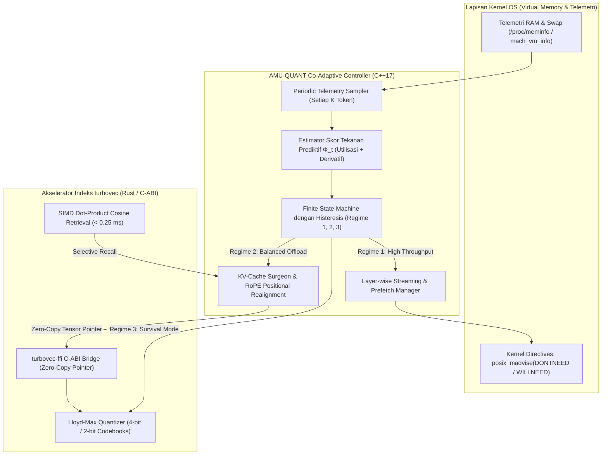

# USULAN TUGAS AKHIR

**Judul Tugas Akhir:**  
**Perancangan dan Evaluasi AMU-QUANT: Algoritma Ko-Adaptasi Layer-wise Weight Streaming dan Kompresi Konteks TurboQuant Menggunakan Pustaka turbovec pada Inferensi Large Language Model di Perangkat Bermemori Terbatas**

**Bidang Minat:** Sains Data (*Data Science*), Pemrosesan Bahasa Alami (*Natural Language Processing*), dan Rekayasa Perangkat Lunak Berperforma Tinggi (*High-Performance Systems for AI*)  
**Tahun Ajaran:** 2026/2027  

---

## ABSTRAK

Menjalankan model bahasa berskala besar (*Large Language Model* / LLM) secara lokal pada perangkat komputer jinjing (*laptop*) kelas standar dengan kapasitas RAM terbatas menghadapi satu kendala utama: memori fisik cepat habis saat teks atau alur penalaran yang dihasilkan semakin panjang. Secara komputasional, alokasi RAM oleh LLM terbagi menjadi dua komponen utama yang saling memperebutkan ruang memori: (1) **Bobot Model (*Model Weights*)** statis yang dimuat ke dalam memori (misalnya format terkuantisasi GGUF) yang telah menghabiskan sebagian besar kapasitas RAM sejak inisialisasi, dan (2) **Memori Konteks (*Key-Value Cache* / KV-Cache)** dinamis yang membengkak secara linier proporsional terhadap panjang token generasi (*autoregressive decoding*). Ketika ukuran KV-Cache membesar atau terdapat aplikasi pihak ketiga yang berjalan bersamaan, total kebutuhan memori melewati kapasitas fisik RAM, memicu pemindahan paksa halaman memori bobot ke penyimpanan SSD (*swapping / page thrashing*) atau terminasi mendadak oleh mekanisme *Out-of-Memory (OOM) Killer*.

Pendekatan terdahulu memiliki kesenjangan kritis: metode *layer-streaming* murni (seperti AirLLM dan `mmap` pasif pada `llama.cpp`) membaca bobot per layer dari SSD tetapi membiarkan KV-Cache membesar tanpa batas di RAM; metode pemotongan konteks (StreamingLLM, H2O, ThinKV, Lethe) membuang token lama secara permanen (*evict-to-trash*) sehingga menimbulkan kehilangan memori permanen (*permanent context loss*) serta buta terhadap telemetri RAM OS; kompresi TurboQuant eksperimental pada `llama.cpp` masih bersifat statis sebelum inferensi; dan pustaka performa tinggi `turbovec` (Rust) belum memiliki jembatan *Foreign Function Interface* (C-ABI FFI) untuk diintegrasikan dengan `llama.cpp` (C++).

Penelitian ini mengusulkan **AMU-QUANT**, sebuah algoritma inferensi ko-adaptif berbasis C++17 dan Rust yang memantau telemetri memori sistem operasi secara berkala selama fase inferensi. Saat tekanan memori terdeteksi menipis, AMU-QUANT secara dinamis memangkas token lama dari KV-Cache fisik `llama.cpp` dan mengarsipkannya ke dalam indeks vektor terkompresi `turbovec` (4-bit atau 2-bit) melalui jembatan C-ABI `turbovec-ffi` secara *zero-copy*. Pada saat yang sama, AMU-QUANT mengatur pelepasan halaman layer bobot yang telah selesai dihitung via panggilan kernel `posix_madvise(..., POSIX_MADV_DONTNEED / WILLNEED)` agar alokasi bobot dan KV-Cache berada dalam ekuilibrium dinamis. Dari sudut pandang Sains Data dan NLP, penelitian ini memformulasikan optimasi representasi vektor berdimensi tinggi melalui kuantisasi skalar Lloyd-Max, pemodelan prediktif deret waktu (*time-series forecasting*) pada telemetri memori OS, serta evaluasi statistik terhadap distribusi probabilitas token (*Perplexity*) dan akurasi temu kembali informasi (*Information Retrieval / Recall@K*). Evaluasi empiris digeneralisasikan pada spektrum model dari kelas kompak hingga skala besar di lingkungan RAM terbatas.

**Kata Kunci:** *Large Language Model (LLM)*, *Layer-wise Weight Streaming*, *Key-Value Cache*, *TurboQuant*, *turbovec*, *Memory Pressure*, *llama.cpp*, *Foreign Function Interface (FFI)*, *Data Science*, *Natural Language Processing*.

---

## BAB I: PENDAHULUAN

### 1.1 Latar Belakang Masalah
Kemajuan mutakhir kecerdasan artifisial generatif telah menempatkan *Large Language Models* (LLMs) sebagai fondasi utama bagi berbagai tugas penalaran (*reasoning*), pemrograman (*code generation*), dan sintesis dokumen komprehensif. Menjalankan model-model ini secara lokal pada perangkat pengguna (*on-device local inference*) menawarkan keunggulan mendasar dalam hal privasi data pengguna, ketiadaan latensi jaringan, serta eliminasi ketergantungan biaya API pihak ketiga berbasis *cloud*.

Namun, menjalankan LLM secara lokal pada laptop standar atau komputer personal dengan kapasitas memori fisik (RAM) terbatas (misalnya 8 GB hingga 16 GB) menghadapi satu kendala mendasar: **memori cepat habis saat teks yang dihasilkan semakin panjang**. Di dalam arsitektur komputer, alokasi RAM oleh proses inferensi LLM terbagi menjadi dua komponen utama yang saling berkompetisi memperebutkan ruang memori:

1. **Bobot Model (*Model Weights*):**  
   Ukuran file model yang dimuat ke dalam memori (misalnya dalam format terkuantisasi GGUF 4-bit) memakan porsi besar RAM fisik sejak awal dijalankan. Ketika digabungkan dengan pemakaian RAM dari sistem operasi dan kernel itu sendiri, sisa ruang memori bebas pada perangkat menjadi sangat sempit bahkan sebelum proses generasi teks dimulai. Fenomena ini berlaku umum pada berbagai kelas model; baik model kelas menengah (7B–8B) pada laptop RAM 8 GB, maupun model kelas 14B, 32B, hingga 70B pada perangkat RAM 16 GB–32 GB.
2. **Memori Konteks (*Key-Value Cache* / KV-Cache):**  
   Saat model mulai menghasilkan kata demi kata (*autoregressive decoding*), sistem harus menyimpan riwayat status representasi tersembunyi (*hidden states*) di dalam *Key-Value Cache* (KV-Cache) dari mekanisme *attention*. Semakin panjang obrolan atau alur penalaran bertingkat yang dihasilkan (mencapai ribuan token), ukuran KV-Cache akan terus membengkak secara linier dan memakan tambahan ruang RAM fisik yang signifikan.

Ketika ukuran KV-Cache bertambah besar atau ada aplikasi lain (seperti peramban web atau editor kode) yang dibuka secara bersamaan oleh pengguna, total kebutuhan memori akan melewati batas fisik RAM perangkat. Akibatnya, sistem operasi terpaksa memindahkan sebagian memori bobot model dari RAM ke media penyimpanan sekunder SSD (*swapping / page thrashing*). Hal ini membuat kecepatan generasi token turun drastis hingga tidak dapat digunakan, atau proses inferensi dihentikan mendadak oleh kernel sistem operasi melalui *Out-of-Memory (OOM) Killer*.

---

### 1.2 Analisis Kritis Solusi Terdahulu dan Celah Riset (*Literature & System Gaps*)

Berbagai penelitian dan sistem inferensi mutakhir telah mencoba mengatasi keterbatasan memori ini, namun masing-masing menyisakan kelemahan sistemik yang mendasar:

1. **Sistem Layer-Streaming Tidak Mengurus Pembengkakan KV-Cache:**  
   Metode seperti AirLLM ([Lyogavin, 2024](https://github.com/lyogavin/airllm)) atau fitur pemetaan memori virtual (`mmap`) pada `llama.cpp` ([Gerganov et al., 2026](https://github.com/ggml-org/llama.cpp)) mampu membaca bobot model secara bertahap per layer dari SSD ke RAM. Namun, metode tersebut membiarkan KV-Cache untuk seluruh layer transformator terus bertambah besar di dalam RAM fisik. Ketika konteks percakapan memanjang, KV-Cache merebut ruang memori fisik yang dialokasikan sistem operasi untuk *page cache buffer*, sehingga sistem tetap mengalami kegagalan OOM saat menangani teks berkonteks panjang.
2. **Pemotongan Konteks Konvensional Menyebabkan Model Kehilangan Informasi (*Evict-to-Trash*):**  
   Metode pemangkasan KV-cache seperti StreamingLLM ([Xiao et al., ICLR 2024](https://arxiv.org/abs/2309.17453)), H2O ([Zhang et al., NeurIPS 2023](https://arxiv.org/abs/2306.14048)), ThinKV ([ICLR 2026](https://arxiv.org/abs/2510.01290)), dan Lethe ([AAAI 2026](https://arxiv.org/abs/2511.12612)) mengatasi memori penuh dengan cara menghapus token-token lama dari KV-Cache. Kelemahannya, token yang dipangkas dibuang secara permanen ke tempat sampah (*evict-to-trash*), mengakibatkan model mengalami *permanent context loss* dan gagal mengingat fakta awal atau tengah. Selain itu, seluruh algoritma tersebut sepenuhnya buta terhadap telemetri memori nyata sistem operasi karena pemangkasan hanya didasarkan pada ambang batas token internal yang statis.
3. **Kompresi TurboQuant di Ekosistem llama.cpp Masih Bersifat Statis:**  
   Metode kompresi vektor daring tanpa pelatihan TurboQuant ([Zandieh et al., Google Research, ICLR 2026](https://arxiv.org/abs/2504.19874)) yang mulai dieksplorasi pada cabang pengembangan `llama.cpp` oleh komunitas riset seperti TheTom ([2026](https://github.com/TheTom/llama-cpp-turboquant)) dan AmesianX ([2026](https://github.com/AmesianX/TurboQuant)), serta diskusi resmi di repositori utama `llama.cpp` ([Issue #20977](https://github.com/ggml-org/llama.cpp/issues/20977) dan [PR #21038](https://github.com/ggml-org/llama.cpp/pull/21038)), hanya bisa diatur di awal sebelum model berjalan (*statically initialized*). Pendekatan statis ini belum mampu menyesuaikan tingkat kuantisasi secara otomatis ketika RAM tiba-tiba penuh di tengah proses generasi akibat fluktuasi beban sistem operasi.
4. **Pustaka turbovec Belum Terhubung ke Mesin C++ (llama.cpp):**  
   Pustaka `turbovec` ([Codrai, 2026](https://github.com/RyanCodrai/turbovec)) yang ditulis menggunakan bahasa Rust berperforma tinggi mampu memadatkan ukuran vektor hingga 7,8 kali lebih hemat (mode 4-bit) dan 15,5 kali lebih hemat (mode 2-bit) dalam hitungan mikrodetik menggunakan instruksi register SIMD CPU modern. Namun, `turbovec` baru mendukung bahasa Rust dan Python, serta belum pernah dihubungkan ke mesin inferensi `llama.cpp` (C++) untuk menampung dan memulihkan KV-Cache yang terpotong.

---

### 1.3 Solusi yang Diusulkan: Algoritma AMU-QUANT

Untuk menyelesaikan persoalan mendasar di atas, penelitian ini mengusulkan algoritma baru bernama **AMU-QUANT** yang dibangun secara terintegrasi menggunakan bahasa C++17 dan Rust. Cara kerja AMU-QUANT diformulasikan secara praktis dan ko-adaptif:

* **Pemantauan Telemetri Memori OS:** Algoritma secara aktif memonitor sisa RAM fisik dan laju perubahan konsumsi memori perangkat saat LLM sedang menghasilkan teks.
* **Mekanisme Evict-to-Index Dinamis:** Jika sisa RAM mulai menipis melewati batas aman, AMU-QUANT memotong token tengah dari KV-Cache fisik di `llama.cpp` agar ruang RAM fisik langsung lega, lalu memindahkan representasi vektor token tadi ke dalam indeks terkompresi `turbovec` (mode 4-bit atau 2-bit) melalui jembatan kode C-ABI FFI (`turbovec-ffi`) secara *zero-copy*.
* **Koordinasi Layer Prefetching:** AMU-QUANT mengatur pelepasan halaman memori layer model yang sudah selesai dihitung menggunakan direktif kernel `posix_madvise(..., POSIX_MADV_DONTNEED)` serta melakukan *prefetching* (`POSIX_MADV_WILLNEED`) untuk layer mendatang, sehingga alokasi bobot model dan KV-Cache tidak saling berebut memori.
* **Temu Kembali Konteks SIMD:** Saat inferensi membutuhkan konteks lama, AMU-QUANT melakukan pencarian kemiripan kosinus berkecepatan tinggi (<0,25 ms) pada indeks `turbovec` menggunakan instruksi SIMD CPU untuk memulihkan informasi penting.

---

### 1.4 Perspektif Sains Data dan Pemrosesan Bahasa Alami (*Data Science & NLP*)

Secara keilmuan, penelitian ini berakar kuat pada ranah **Sains Data (*Data Science*)** dan **Pemrosesan Bahasa Alami (*Natural Language Processing*)**:

1. **Optimasi Representasi Data Vektor Berdimensi Tinggi:**  
   Mengkaji perilaku geometris representasi tersembunyi (*hidden state embeddings*) berdimensi tinggi ($d = 2048$ hingga $d = 8192$) di bawah proyeksi rotasi ortogonal acak, serta menganalisis batas distorsi teoritis kuantisasi skalar Lloyd-Max 4-bit dan 2-bit dalam meminimalkan kehilangan informasi semantik (*Mean Squared Error*).
2. **Pemodelan Prediktif Deret Waktu (*Time-Series Forecasting* pada Telemetri Memori):**  
   Menerapkan perumusan skor tekanan prediktif $\Phi_t$ berbasis kombinasi linear antara utilisasi instan dan estimasi turunan laju perubahan memori ($\frac{dM}{dt}$), yang memproyeksikan risiko kejenuhan RAM pada horizon waktu mendatang ($\tau_{\text{horizon}}$) untuk mengambil tindakan preventif sebelum sistem operasi mengalami *thrashing*.
3. **Evaluasi Statistik Kualitas Bahasa dan Temu Kembali Informasi:**  
   Mengukur dampak kompresi terhadap distribusi probabilitas token menggunakan metrik baku NLP **Perplexity (PPL)** pada korpus benchmark standar (WikiText-2), serta menguji akurasi pemulihan informasi faktual tersembunyi (*Information Retrieval Recall@K*) menggunakan protokol uji *Needle-in-a-Haystack*.

---

### 1.5 Generalisasi Model (Lintas Skala Parameter)

Penelitian ini **tidak terpaku pada satu ukuran model tertentu (seperti model 8B)**, melainkan merumuskan model matematika dan kontroler memori yang berlaku umum (*generalized*) pada berbagai skala arsitektur LLM:

* **Model Kompak (Sub-3B Parameter):** Menguji ketahanan inferensi pada perangkat berkapasitas RAM sangat terbatas (seperti Single Board Computer atau laptop RAM 4 GB–8 GB) dengan panjang konteks ekstrem (8K–32K token).
* **Model Menengah (7B–8B Parameter):** Menguji kondisi di mana bobot model mendekati separuh kapasitas RAM 8 GB–16 GB, membuktikan efektivitas pemangkasan KV-Cache saat jendela percakapan membesar.
* **Model Skala Besar (14B, 32B, hingga 70B Parameter):** Menguji kondisi di mana ukuran bobot model itu sendiri melampaui seluruh kapasitas RAM fisik perangkat, membuktikan peran vital streaming layer aktif yang bekerja harmonis bersama pengarsipan konteks *in-memory*.

---

### 1.6 Rumusan Masalah

Penelitian ini merumuskan empat pertanyaan penelitian ilmiah (*Research Questions*):

1. **RQ1:** Bagaimana karakteristik perebutan memori fisik (*memory contention*) antara *page cache buffer* untuk bobot model dan pertumbuhan KV-Cache memengaruhi laju *major page faults*, *inter-token latency*, dan probabilitas OOM pada berbagai rasio ukuran model terhadap kapasitas RAM perangkat?
2. **RQ2:** Bagaimana merancang antarmuka C-ABI FFI (`turbovec-ffi`) antara C++ (`llama.cpp`) dan Rust (`turbovec`) agar transfer pointer vektor token dapat berlangsung secara *zero-copy* dengan *overhead* latensi di bawah 1 ms?
3. **RQ3:** Bagaimana memodelkan kontroler ko-adaptif prediktif ($\Phi_t$) yang mengatur transisi rejim secara *closed-loop* dengan *hysteresis* guna mencegah *thrashing* antara streaming bobot layer dan kuantisasi konteks (FP16 $\to$ 4-bit $\to$ 2-bit)?
4. **RQ4:** Seberapa besar peningkatan kelangsungan hidup inferensi (*survival rate*), efisiensi RAM fisik, dan pelestarian akurasi pengambilan informasi (*Retrieval Recall@1*) yang dicapai oleh AMU-QUANT dibandingkan dengan metode *layer-streaming* murni dan pemangkasan naif (*evict-to-trash*)?

---

### 1.7 Batasan Masalah dan Asumsi Teknis

1. **Format Model & Kuantisasi:** Model yang diuji berformat GGUF dengan kuantisasi bobot standar Q4_K_M dan Q2_K, mencakup ragam arsitektur Transformer decoder-only (Llama-3, Qwen-2.5, DeepSeek-Distill).
2. **Implementasi Sistem:** Kode sumber inti murni berbasis C++17 dan Rust tanpa *dependency runtime* Python pada saat inferensi berjalan.
3. **Pengendalian Memori Kernel:** Memanfaatkan API POSIX kernel (`posix_madvise`) pada macOS Darwin (`mach_vm_info`) dan Linux (`/proc/meminfo`).

---

### 1.8 Tujuan Penelitian

1. **Tujuan Sains Data & NLP:** Mengukur secara statistik trade-off antara kompresi representasi vektor KV-Cache (Lloyd-Max 4-bit/2-bit) terhadap kestabilan distribusi perplexity teks dan akurasi temu kembali informasi.
2. **Tujuan Rekayasa Perangkat Lunak:** Membangun jembatan FFI lintas-bahasa C++/Rust (`turbovec-ffi`) yang aman (*memory-safe*) dan berefisiensi tinggi.
3. **Tujuan Sistem:** Membuktikan secara empiris bahwa AMU-QUANT mencapai kelulusan inferensi 100% (*zero OOM*) pada perangkat dengan keterbatasan memori tanpa membuang konteks lama secara permanen.

---

## BAB II: TINJAUAN PUSTAKA DAN MATRIKS KEBARUAN

### 2.1 Matriks Komparatif State-of-the-Art

| Metode / Sistem | Referensi Utama | Bahasa | Layer Streaming (Model > RAM) | Kompresi Konteks TurboQuant | Kesadaran Tekanan Memori OS | Mekanisme Evict-to-Index & SIMD Recall | Beban Runtime Eksternal |
|:---|:---|:---:|:---:|:---:|:---:|:---:|:---:|
| **AirLLM** | [Lyogavin (2024)](https://github.com/lyogavin/airllm) | Python | Ya (File Splitting) | Tidak | Tidak | Tidak | Python Runtime (Lambat) |
| **StreamingLLM** | [ICLR 2024](https://arxiv.org/abs/2309.17453) | Python | Tidak | Tidak | Tidak | Tidak (Permanen Dihapus) | Python Runtime |
| **H2O** | [NeurIPS 2023](https://arxiv.org/abs/2306.14048) | Python | Tidak | Tidak | Tidak | Tidak (Permanen Dihapus) | Python Runtime |
| **ThinKV** | [ICLR 2026](https://arxiv.org/abs/2510.01290) | Python | Tidak | Tidak | Tidak | Tidak (Permanen Dihapus) | Python Runtime |
| **Lethe** | [AAAI 2026](https://arxiv.org/abs/2511.12612) | Python | Tidak | Tidak | Tidak | Tidak (Permanen Dihapus) | Python Runtime |
| **llama.cpp (mmap)**| [Gerganov et al. (2026)](https://github.com/ggml-org/llama.cpp) | C++ | Pasif (Demand Paging) | Tidak | Tidak | Tidak | Ketiadaan Python (C++) |
| **TurboQuant Fork** | [TheTom / AmesianX (2026)](https://github.com/TheTom/llama-cpp-turboquant) | C++ | Tidak | Ya (Statis Inisial) | Tidak | Tidak | Ketiadaan Python (C++) |
| **turbovec** | [Codrai (2026)](https://github.com/RyanCodrai/turbovec) | Rust | Tidak | Ya (4-bit & 2-bit) | Tidak | Ya (Khusus Vektor DB RAG) | Ketiadaan Python (Rust) |
| **AMU-QUANT** *(Usulan)* | **Tugas Akhir (2026)** | **C++ & Rust FFI** | **Ya (Aktif madvise / Prefetch)** | **Ya (Dinamis Mid-Gen)** | **Ya (Dual-Budget Controller)** | **Ya (turbovec SIMD Recall <0.25 ms)** | **Nihil (Native Unified Binary)** |

---

## BAB III: METODOLOGI PENELITIAN

### 3.1 Alur Kerja Arsitektur Ko-Adaptif

---

### 3.2 Model Matematika Kontroler Ko-Adaptif

Pertidaksamaan kesetimbangan memori ganda (*dual-budget memory equilibrium*) didefinisikan sebagai:

$$M_{\text{ext}}(t) + \sum_{l \in \mathcal{L}_{\text{resident}}(t)} M_{\text{weight}}(l) + M_{\text{KV}}(W_t) + M_{\text{turbovec}}(C_t, b_t) \le M_{\text{limit}}$$

Di mana:
* $M_{\text{limit}} = M_{\text{RAM}} - M_{\text{OS\_reserved}}$: Batas atas aman memori fisik yang dialokasikan.
* $\mathcal{L}_{\text{resident}}(t)$: Himpunan layer model yang sedang residen di RAM.
* $W_t$: Jumlah token aktif pada KV-cache fisik `llama.cpp`.
* $C_t$: Jumlah token yang diarsipkan ke indeks terkompresi `turbovec`.
* $b_t \in \{2, 4\}$: Lebar bit kuantisasi kuantisasi skalar Lloyd-Max.

Fungsi Skor Tekanan Memori Prediktif ($\Phi_t$) dirumuskan sebagai:

$$\Phi_t = \alpha \cdot \frac{M_{\text{proc}}(t)}{M_{\text{limit}}} + \beta \cdot \min\left(1.0, \max\left(0.0, \frac{1}{M_{\text{limit}}} \frac{\Delta M}{\Delta t} \tau_{\text{horizon}}\right)\right)$$

Dengan bobot $\alpha = 0{,}65$, $\beta = 0{,}35$, dan horizon waktu prediksi $\tau_{\text{horizon}} = 2{,}0\text{ detik}$.

---

### 3.3 Skenario Eksperimen Evaluasi Empiris

1. **Skenario 1 — Skalabilitas Panjang Konteks (Clean Run):**  
   Evaluasi pada variasi panjang konteks 2K, 4K, 8K, dan 16K token pada berbagai skala model di lingkungan bebas gangguan untuk mengukur titik batas OOM dan throughput stabil.
2. **Skenario 2 — Injeksi Tekanan Memori Dinamis (Stress Test):**  
   Pengalokasian beban memori eksternal secara mendadak (2 GB–6 GB) saat generasi teks berlangsung untuk menguji respons FSM AMU-QUANT dalam menurunkan beban RAM dan mencegah OOM.
3. **Skenario 3 — Evaluasi Ketahanan Konteks (Needle-in-a-Haystack & PPL):**  
   Pengujian ekstraksi fakta tersembunyi pada variasi kedalaman konteks dokumen (0%, 25%, 50%, 75%, 100%) serta evaluasi statistik distribusi probabilitas token (*Perplexity*) pada dataset standar WikiText-2.

---

## BAB IV: JADWAL KERJA DAN TARGET LUARAN

### 4.1 Target Luaran Penelitian
1. **Naskah Tugas Akhir:** Laporan komprehensif yang memenuhi kaidah akademik Sains Data dan Rekayasa Perangkat Lunak.
2. **Paket Perangkat Lunak Mandiri (*Open Source*):**
   * Pustaka C-ABI `turbovec-ffi` dan C++ Core `amuquant_core` terverifikasi.
   * Repositori GitHub resmi yang mendukung integrasi standar CMake (`find_package` dan `FetchContent`).
3. **Publikasi Ilmiah:** Naskah artikel ilmiah untuk dipublikasikan pada jurnal nasional terakreditasi SINTA 2 atau konferensi internasional bereputasi IEEE/ACM pada bidang *Systems and Data Science for Generative AI*.

---

## DAFTAR PUSTAKA UTAMA

1. **Zandieh, A., Daliri, M., Hadian, M., & Mirrokni, V. (2026).** *TurboQuant: Online Vector Quantization with Near-optimal Distortion Rate*. In *Proceedings of the International Conference on Learning Representations (ICLR 2026)*. arXiv: [2504.19874](https://arxiv.org/abs/2504.19874).
2. **Codrai, R. (2026).** *turbovec: High-performance, in-process vector search index in Rust implementing Google Research's TurboQuant*. GitHub: [https://github.com/RyanCodrai/turbovec](https://github.com/RyanCodrai/turbovec).
3. **Gerganov, G., et al. (2026).** *llama.cpp: Inference of LLaMA model in pure C/C++*. GitHub: [https://github.com/ggml-org/llama.cpp](https://github.com/ggml-org/llama.cpp).
4. **Lyogavin. (2024).** *AirLLM: Layer-wise LLM Inference Optimization for Resource-Constrained Hardware*. GitHub: [https://github.com/lyogavin/airllm](https://github.com/lyogavin/airllm).
5. **Xiao, G., Tian, Y., Chen, B., Han, S., & Lewis, M. (2024).** *Efficient Streaming Language Models with Attention Sinks (StreamingLLM)*. In *ICLR 2024*. arXiv: [2309.17453](https://arxiv.org/abs/2309.17453).
6. **Zhang, Z., et al. (2023).** *H2O: Heavy-Hitter Oracle for Efficient Generative Inference of Large Language Models*. In *NeurIPS 2023*. arXiv: [2306.14048](https://arxiv.org/abs/2306.14048).
7. **ThinKV Authors. (2026).** *ThinKV: Thought-Adaptive KV Cache Compression for Reasoning Models*. In *ICLR 2026*. arXiv: [2510.01290](https://arxiv.org/abs/2510.01290).
8. **Lethe Authors. (2026).** *Lethe: Layer-Adaptive KV Cache Eviction with Dynamic Sparsity Allocation*. In *AAAI 2026*. arXiv: [2511.12612](https://arxiv.org/abs/2511.12612).
9. **TheTom. (2026).** *llama-cpp-turboquant: Experimental TurboQuant integration in llama.cpp*. GitHub: [https://github.com/TheTom/llama-cpp-turboquant](https://github.com/TheTom/llama-cpp-turboquant).
10. **AmesianX. (2026).** *TurboQuant: C++ Implementation and Exploration for Quantized Inference*. GitHub: [https://github.com/AmesianX/TurboQuant](https://github.com/AmesianX/TurboQuant).
