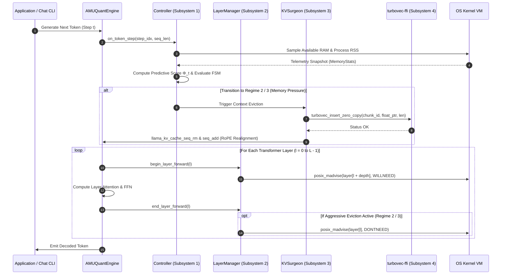

# AMU-QUANT System Architecture

This document presents the in-depth technical architecture of **AMU-QUANT**, a host-aware co-adaptive runtime engine for LLM inference on memory-constrained devices, integrating runtime memory pressure arbitration, transactional KV-cache surgery, and episodic vector memory compression.

---

## 1. High-Level Architecture Overview

AMU-QUANT consists of four integrated subsystems executing entirely in-process in native C++17 with optional Rust FFI bindings:

```mermaid
flowchart TB
    subgraph Host_OS ["Operating System Kernel & Host Headroom"]
        ProcMem["mach_vm_info / sysctl / procfs (Process RSS, Free RAM, Swap)"]
        KernelMadvise["Page Directives: posix_madvise (DONTNEED / WILLNEED)"]
    end

    subgraph AMU-QUANT_Core ["AMU-QUANT Core Runtime Engine (C++17)"]
        subgraph Mem_Controller ["Subsystem 1: Host-Aware Adaptive Controller"]
            OS_Sampler["Host Telemetry Sampler (K-token stride)"]
            PredictiveEngine["Dual-Budget Memory Pressure Estimator (Φ_t)"]
            RegimeStateMachine["Tri-Modal Hysteresis State Machine"]
        end

        subgraph KV_Manager ["Subsystem 2: Transactional KV-Cache Surgery Engine"]
            TokenMap["TokenIndexMap: Physical-to-Logical ID Translation"]
            KVSurgeon["2-Phase Commit Eviction: seq_rm & seq_add"]
            ContextBuffer["Physical KV Working Set (llama_context)"]
        end

        subgraph Layer_Manager ["Subsystem 3: Virtual Memory Page Manager (Future Extension)"]
            LayerRegistry["Layer Address Space Registry"]
            PagePaging["posix_madvise Virtual Memory Paging"]
        end
    end

    subgraph Vector_Memory ["Subsystem 4: Episodic Vector Memory (Canonical C++ / Optional Rust FFI)"]
        C_ABI_Bridge["turbovec-ffi C-ABI Interface"]
        TurboIndex["Episodic Vector Memory (Lloyd-Max 4-bit / 2-bit Compressed)"]
        SIMD_Search["AVX2 / ARM NEON SIMD Dot-Product Search Engine"]
        ContextRestorer["Selective Context Semantic Retriever"]
    end

    %% Telemetry & Control Flows
    ProcMem -->|Process RSS, Host Available RAM, Swap| OS_Sampler
    OS_Sampler --> PredictiveEngine
    PredictiveEngine --> RegimeStateMachine
    RegimeStateMachine -->|Regime 1: Normal, Regime 2: Offload, Regime 3: Survival| KV_Manager

    %% Transactional KV Surgery Flow
    ContextBuffer -->|Physical Tokens [p_start, p_end)| KVSurgeon
    KVSurgeon -->|Phase 1: Query Logical IDs| TokenMap
    KVSurgeon -->|Phase 1: Insert Hidden States h_t| C_ABI_Bridge
    C_ABI_Bridge --> TurboIndex
    TurboIndex -->|Verify TURBOVEC_STATUS_OK| KVSurgeon
    KVSurgeon -->|Phase 2: seq_rm & seq_add| ContextBuffer
    KVSurgeon -->|Phase 2: Update Translation Mapping| TokenMap

    %% Context Recall
    SIMD_Search -->|Top-K Matching Logical IDs & Cosine Scores| ContextRestorer
    ContextRestorer -->|Semantic Context Verification| ContextBuffer
```

---

## 2. Core Subsystems Specification

### 2.1 Subsystem 1: Dual-Budget Host-Aware Adaptive Controller
The controller operates as the primary decision-maker, evaluated synchronously every $K$ generated tokens ($K \in [4, 16]$) during autoregressive decoding.

* **Key Responsibilities:**
  1. Gathers dual-budget host telemetry: Process Resident Set Size ($\mathcal{U}_{\text{process}}$), host available RAM ($\mathcal{U}_{\text{system}}$), and kernel swap thrashing ($\mathcal{P}_{\text{swap}}$).
  2. Evaluates the Host-Aware Pressure Metric:
     $$\Phi_t = \max(\mathcal{U}_{\text{process}}, \mathcal{U}_{\text{system}}) + \beta \cdot \mathcal{P}_{\text{growth}} + \gamma \cdot \mathcal{P}_{\text{swap}}$$
  3. Transitions between three operational regimes: **Regime 1 (High-Throughput)**, **Regime 2 (Balanced Offload)**, and **Regime 3 (Ultra-Low Survival)**.
  4. Enforces a hysteresis guard band ($\delta_{\text{hyst}}$) to prevent flapping between operational modes.

### 2.2 Subsystem 2: Transactional KV-Cache Surgery & TokenIndexMap
Unlike traditional methods that drop tokens irrevocably into trash (e.g., StreamingLLM, H2O), AMU-QUANT performs safe transactional eviction:

* **TokenIndexMap**:
  - Translates shifting physical KV-cache slots (`0 .. N-1`) to immutable logical token sequence IDs (`0 .. M-1`).
  - Ensures that when middle tokens are excised and trailing tokens are shifted down via `llama_memory_seq_add(..., delta)`, the representation extractor and vector memory always reference immutable logical tokens without index divergence.
* **Two-Phase Transactional Commit**:
  - **Phase 1 (Validation & Staging)**: Resolves logical IDs for all tokens in candidate slice $[p_{\text{start}}, p_{\text{end}})$. Extracts hidden-state representations $\mathbf{h}_t \in \mathbb{R}^d$ and verifies non-null pointers. Inserts vectors into `turbovec` and validates `TURBOVEC_STATUS_OK`. If ANY insertion fails or representation is missing, eviction aborts immediately with zero modifications to the physical KV cache.
  - **Phase 2 (Physical Pruning & Realignment)**: Invokes `seq_rm` and `seq_add` to excise physical slots and close the sequence gap. Prunes `TokenIndexMap` to reflect the new contiguous physical layout.

### 2.3 Subsystem 3: Episodic Vector Memory (Canonical C++ / Optional Rust FFI)
Episodic memory archives high-dimensional hidden states ($\mathbf{h}_t \in \mathbb{R}^d$) into compressed vector memory:
- **Canonical Default**: Pure C++17 SIMD implementation utilizing AVX2 / ARM NEON intrinsics with zero external dependencies.
- **Optional Rust Backend**: `turbovec-ffi` static library compiled via Cargo when `-DAMUQUANT_USE_RUST_BACKEND=ON`.
- **Lloyd-Max Quantization**: Optimal centroid lookup tables ($4\text{-bit} \to 2\text{-bit}$) minimizing mean squared quantization distortion ($\mathbb{E}[|c_i - q_j|^2]$).

### 2.4 Subsystem 4: Virtual Memory Page Manager (Future Work)
`LayerManager` encapsulates OS virtual memory primitives via `posix_madvise(DONTNEED / WILLNEED)`:
- Validated as an isolated page management primitive via unit test suites (`test_amuquant_pipeline`).
- Direct integration into `llama.cpp`'s internal GGML compute graph forward execution is scoped as documented future research.
    This notifies the Darwin/Linux virtual memory manager that the underlying physical pages can be immediately reclaimed from the OS page cache without writeback penalties.
  * **Asynchronous Prefetching:** When memory headroom permits (Regime 1 & 2), before layer $l$ begins execution, the manager dispatches read-ahead advisories for upcoming layers ($l + 1, \dots, l + \text{depth}$):
    ```c
    posix_madvise(layer[l + 1].addr_start, layer[l + 1].byte_len, POSIX_MADV_WILLNEED);
    ```
    On Windows systems, the equivalent native Win32 calls `PrefetchVirtualMemory()` and `VirtualUnlock()` are utilized.

### 2.3 Subsystem 3: Dynamic KV-Cache Surgery Engine
During extended multi-turn dialogs and multi-step reasoning, physical KV-cache memory expands linearly. AMU-QUANT partitions the active KV sequence into three distinct functional zones:

1. **Attention Sinks ($W_{\text{sink}}$):** The initial 4 tokens (tokens 0 to 3) are permanently preserved in the physical KV-cache to maintain softmax normalization stability (following the attention sink phenomenon).
2. **Active Working Window ($W_{\text{recent}}$):** The most recent $N_{\text{recent}}$ tokens serving as the immediate autoregressive receptive field.
3. **Eviction Candidate Window ($W_{\text{middle}}$):** The tokens situated between the attention sinks and the recent window ($p \in [W_{\text{sink}}, T - W_{\text{recent}}]$).

* **KV Surgery Mechanics:**
  * **Context Representation Semantics (Episodic Hidden-State Memory):** AMU-QUANT preserves context through an **Episodic Semantic Memory Architecture**: It extracts high-dimensional normalized token hidden-state representations ($\mathbf{h}_t \in \mathbb{R}^d$, derived via `llama_get_embeddings_ith()`) at candidate positions before eviction. Physical multi-head attention KV slots in `llama.cpp` are safely pruned via `llama_memory_seq_rm()` only after atomic archiving into `turbovec` is verified. Upon context recall queries, relevant representations are retrieved via SIMD cosine search (< 0.25 ms) and reinjected for autoregressive attention.
  * Candidate tokens are extracted as contiguous float vectors and passed directly into the `turbovec` index via raw memory pointers (*zero-copy*).
  * The sequence slot range is excised from physical KV memory using `llama_kv_cache_seq_rm(ctx, 0, p_start, p_end)`.
  * Position indices of all subsequent tokens are shifted using `llama_kv_cache_seq_add(ctx, 0, p_end, -1, delta)` to maintain mathematical continuity for Rotary Position Embedding (RoPE).

### 2.4 Subsystem 4: turbovec In-Process Vector Index (Rust C-ABI)
Employs an embedded, thread-safe instance of the Google Research TurboQuant algorithm implemented in Rust:

* **Lloyd-Max Scalar Quantization:** Rotates incoming token vectors with a deterministic block-orthogonal matrix $\mathbf{Q} \in \mathbb{R}^{B \times B}$ ($B=64$) and discretizes components to precomputed Lloyd-Max codebooks (4-bit: 16 levels, 2-bit: 4 levels).
* **SIMD-Accelerated Cosine Retrieval:** Decodes quantized vector blocks in CPU vector registers (ARM NEON or AVX2/AVX-512) to compute Top-$K$ cosine similarity queries in sub-millisecond latency (<0.25 ms).
* **In-Place Requantization:** Under critical memory pressure (Regime 3), the index executes an optimal Lloyd-Max transformation pass ($\text{LUT}_{4\to 2}$) over all stored 4-bit nibbles, condensing them to 2-bit dibits in-place with minimal quantization distortion ($|c_i - q_j|^2$).

---

## 3. Autoregressive Execution Lifecycle

The diagram below illustrates the exact execution lifecycle for generating a single token under AMU-QUANT orchestration:



---

## 4. Zero-Copy Pointer Passing & Memory Safety

To eliminate serialization overhead between C++ and Rust, AMU-QUANT adheres to strict zero-copy invariants across the foreign function boundary:

```c
// C++ callers pass raw pointers to existing contiguous float arrays
TurbovecStatus turbovec_insert_zero_copy(
    TurbovecIndexHandle* handle,
    uint64_t chunk_id,
    const float* float_ptr,
    size_t len
);
```

### Invariants:
1. **No Intermediate Buffer Copies:** Rust creates a transient, read-only slice (`std::slice::from_raw_parts(float_ptr, len)`) directly mapping C++ memory for immediate vector rotation and quantization into its own compact index structure.
2. **Panic Boundary Protection:** Every exported Rust C-ABI symbol is wrapped in `std::panic::catch_unwind(|| { ... })`. Any unhandled panic is intercepted at the FFI boundary and converted into a standard C enum status code (`TURBOVEC_ERR_PANIC_CAUGHT`), preventing undefined unwinding across foreign stack frames.
3. **Thread Safety:** The Rust handle wraps the vector index in an `std::sync::RwLock`, permitting concurrent multi-threaded SIMD queries while synchronizing rare insertion and requantization operations.
