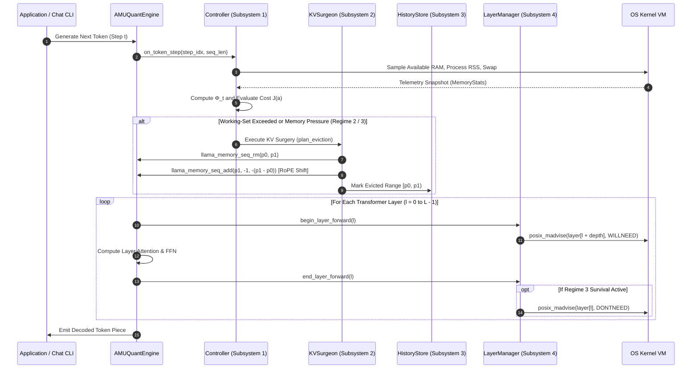

# AMU-QUANT System Architecture Specification

---

## 1. System Overview

**AMU-QUANT** is a native C++17 inference and memory-management architecture designed for resource-constrained edge devices (Apple Silicon Metal and ARM64/x86_64 CPUs). It integrates continuous operating system telemetry, a predictive cost-benefit memory controller, physical Key-Value cache sliding-window surgery with RoPE realignment, and canonical conversation history for context reconstruction.

```mermaid
flowchart TD
    subgraph Host_Environment ["Host Virtual Memory & Hardware Telemetry"]
        ProcMem["Process RSS & Available RAM (/proc/meminfo, mach_vm_info)"]
        SwapPressure["Swap In/Out Thrashing Rate (dSwap/dt)"]
        KernelMadvise["Kernel Directives: posix_madvise & mincore(2) Residency"]
    end

    subgraph AMUQuant_Core ["AMU-QUANT Core Runtime (Native C++17)"]
        subgraph Subsystem_1 ["Subsystem 1: Dual-Budget Predictive Controller"]
            OS_Sampler["SystemTelemetry Sampler"]
            PredictiveEngine["Predictive Pressure Metric (Φ_t)"]
            UtilityOptimization["Multi-Action Cost-Benefit Arbitration (min J(a))"]
            RegimeStateMachine{"Hysteresis Finite State Machine"}
        end

        subgraph Subsystem_2 ["Subsystem 2: Transactional KV-Cache Surgeon"]
            KVSurgeon["KVSurgeon: Plan & Execute Eviction"]
            TokenMap["TokenIndexMap (Physical-to-Logical ID Translation)"]
            RoPEShift["Positional Realignment: llama_memory_seq_add(delta)"]
        end

        subgraph Subsystem_3 ["Subsystem 3: Canonical History & Context Reconstruction"]
            HistoryStore["CanonicalHistoryStore (Verbatim Turn Archive)"]
            EvictionTracker["Eviction Range Flagging: is_evicted_from_kv"]
            LexicalSearch["BM25 / Keyword Retrieval Engine"]
            PromptReconstructor["System Memory Context Reconstruction"]
        end

        subgraph Subsystem_4 ["Subsystem 4: Virtual Memory Page Manager"]
            LayerRegistry["Layer Address Space Registry"]
            PagePaging["posix_madvise Virtual Memory Paging & mincore Verification"]
        end
    end

    subgraph Llama_Engine ["Underlying LLM Engine: llama.cpp"]
        MmapWeights["Model Weights (Unified GGUF via mmap)"]
        ContextBuffer["Physical Key-Value Cache Buffer (Bounded O(1))"]
    end

    %% Telemetry & Control Flows
    ProcMem -->|Process RSS, Host Available RAM| OS_Sampler
    SwapPressure -->|Swap Thrashing Rate| OS_Sampler
    OS_Sampler --> PredictiveEngine
    PredictiveEngine --> UtilityOptimization
    UtilityOptimization --> RegimeStateMachine
    RegimeStateMachine -->|Regime 1: Normal, Regime 2: Offload, Regime 3: Survival| KVSurgeon

    %% KV Surgery Flow
    ContextBuffer -->|Physical Tokens [p_start, p_end)| KVSurgeon
    KVSurgeon -->|Phase 1: Validate Logical Bounds| TokenMap
    KVSurgeon -->|Phase 2: Prune Sequence & Realign RoPE| ContextBuffer
    KVSurgeon -->|Phase 3: Update Index Translation| TokenMap
    KVSurgeon -->|On Commit: Eviction Range Callback| EvictionTracker
    EvictionTracker -->|Flag Evicted Turns| HistoryStore

    %% Retrieval & Context Reconstruction
    UserQuery["Incoming User Query / Agent Turn"] --> LexicalSearch
    LexicalSearch -->|Query Keyword Match on Evicted Turns| HistoryStore
    HistoryStore -->|Retrieved Historical Facts| PromptReconstructor
    PromptReconstructor -->|Inject Structured System Memory| ContextBuffer

    %% OS Layer Management
    RegimeStateMachine -.->|Advisory Paging Directives| PagePaging
    PagePaging -.->|posix_madvise(DONTNEED / WILLNEED)| KernelMadvise
    KernelMadvise --> MmapWeights
```

---

## 2. Core Subsystems Specification

### 2.1 Subsystem 1: Dual-Budget Host-Aware Adaptive Controller
The controller operates as the primary decision-maker, evaluated periodically every $K$ generated tokens ($K \in [4, 16]$) during autoregressive decoding.

* **Key Responsibilities:**
  1. Gathers dual-budget host telemetry: Process Resident Set Size ($\mathcal{U}_{\text{process}}$), host available RAM ($\mathcal{U}_{\text{system}}$), and kernel swap thrashing ($\mathcal{P}_{\text{swap}}$).
  2. Evaluates the Predictive Pressure Metric:
     $$\Phi_t = \alpha \cdot \max(\mathcal{U}_{\text{process}}, \mathcal{U}_{\text{system}}) + \beta \cdot \mathcal{P}_{\text{growth}} + \gamma \cdot \mathcal{P}_{\text{swap}}$$
  3. Evaluates multi-action cost-benefit utility $J(a)$ incorporating proactive working-set budgeting:
     $$J(a) = \text{OOM\_Risk}(a) + w_{\text{bloat}} \cdot \max\left(0, \frac{|KV_{\text{active}}(a)| - \Omega_{\text{target}}}{\Omega_{\text{target}}}\right) + w_L \cdot L(a) + w_Q \cdot Q(a)$$
  4. Transitions between three operational regimes:
     - **Regime 1 (High-Throughput)**: Unconstrained generation, maximum prefetch depth ($D=3$), no intermediate eviction.
     - **Regime 2 (Balanced Offload)**: Proactive working-set compaction maintaining active physical KV slots within $\Omega_{\text{target}}$ ($\le 96\text{ slots}$).
     - **Regime 3 (Ultra-Low Survival)**: Emergency clamping ($D=0$, minimum attention window $W_{\text{recent}} = 24$), aggressive OS page eviction to prevent out-of-memory termination.
  5. Enforces a hysteresis guard band ($\delta_{\text{hyst}}$) to prevent high-frequency oscillation between operational modes.

### 2.2 Subsystem 2: Transactional KV-Cache Surgery & TokenIndexMap
Unlike methods that discard tokens into an unrecoverable trash buffer (e.g., StreamingLLM, H2O), AMU-QUANT executes coordinated physical cache surgery with RoPE realignment:

* **TokenIndexMap**:
  - Translates shifting physical KV-cache slots (`0 .. N-1`) to immutable logical token sequence IDs (`0 .. M-1`).
  - Ensures that when middle tokens are excised and trailing tokens are shifted down via `llama_memory_seq_add(..., delta)`, the system maintains consistent logical token mapping without positional divergence.
* **Three-Phase Transactional Execution**:
  - **Phase 1 (Validation & Range Planning)**: Computes middle-token eviction bounds $[p_{\text{start}}, p_{\text{end}})$ preserving the initial attention sink $[0, S)$ (e.g. system prompt and master verification key) and recent local context $[N - W, N)$.
  - **Phase 2 (Physical Sequence Pruning & RoPE Realignment)**: Invokes `seq_rm` (`llama_memory_seq_rm`) to excise physical slots $[p_{\text{start}}, p_{\text{end}})$, followed immediately by `seq_add` (`llama_memory_seq_add`) to shift trailing positions left by $\Delta p = -(p_{\text{end}} - p_{\text{start}})$, closing the sequence gap and preserving RoPE rotational phase consistency without KV recomputation.
  - **Phase 3 (Translation Table Update & Eviction Callback)**: Prunes `TokenIndexMap` to reflect the new contiguous physical layout and notifies `CanonicalHistoryStore` of the exact excised logical token span, flagging corresponding conversation turns as evicted.
* **Microsecond Execution Performance**:
  - Measured execution latency of the complete surgery sequence is $\approx 100\ \mu\text{s}$ ($0.10\text{ ms}$), contributing $< 0.2\%$ overhead relative to normal single-token decode latency ($\approx 50\text{ ms}$).

### 2.3 Subsystem 3: Reliable Semantic Memory, Provenance Tracking & Grounding Guardrail
Solves the fundamental failure modes small local language models face during extended multi-turn interactions (lost facts from KV pruning, temporal knowledge clash from outdated facts, and ungrounded hallucinations):

* **The Problem**: Excising intermediate tokens severs attention pathways. Small models (such as Qwen 2.5 3B) not only lose facts when slots are evicted, but also frequently mix outdated facts with newer ones (temporal contradiction) or hallucinate arbitrary answers when retrieval evidence is insufficient.
* **Canonical History Store (`CanonicalHistoryStore`) & Provenance Tracking**:
  - Preserves immutable ground-truth turn records (role, prompt text, response text, token index intervals) in host virtual memory.
  - Automatically flags turns as `is_evicted_from_kv = true` when their attention positions are pruned from the physical KV cache.
  - Attaches structured provenance tags `[Turn X | Source: Role | Status: ACTIVE]` to every recorded entity, enabling automatic citation and deterministic verification.
* **Deterministic Entity-Slot Extraction & Fact Register**:
  - Extracts key-value entity slots (e.g., project name, version, port, configuration parameters) in native C++ without incurring LLM forward-pass latency.
  - Tracks temporal state space: $S_{\text{fact}} \in \{\text{ACTIVE}, \text{SUPERSEDED}, \text{CONTRADICTED}\}$.
  - When an entity is updated in a subsequent turn (e.g. Turn 3 updates a parameter defined in Turn 0), previous entries are automatically marked `SUPERSEDED`, preventing stale knowledge from contaminating reconstructed contexts.
* **Dual-Threshold Grounding Guardrail ($\tau_{\text{evidence}}$) & Calibrated Abstention**:
  - Evaluates relevance score $S_{\text{rel}}$ against the calibrated evidence threshold $\tau_{\text{evidence}}$ (default: $0.25$).
  - If $S_{\text{rel}} \ge \tau_{\text{evidence}}$: Reconstructs prompt with verified active facts, provenance citations, and explicit superseding notes.
  - If $S_{\text{rel}} < \tau_{\text{evidence}}$ or when probed with unmentioned counterfactuals: Injects strict refusal directives (`[RELIABLE MEMORY GUARD: INSUFFICIENT EVIDENCE]`), compelling the model to acknowledge lack of information rather than fabricating ungrounded claims.

### 2.4 Subsystem 4: Virtual Memory Page Manager
`LayerManager` encapsulates OS virtual memory primitives via `posix_madvise(DONTNEED / WILLNEED)`:
* Interfaces with OS virtual memory tables to advise the kernel when weight pages can be discarded from the page cache without writeback penalties.
* Includes physical page residency verification via `mincore(2)` to inspect actual in-RAM page table state.

---

## 3. Autoregressive Execution Lifecycle

The diagram below illustrates the exact execution lifecycle for generating tokens under AMU-QUANT orchestration:



---

## 4. Native C++17 Safety & Performance Guarantees

1. **Zero External Language Runtimes**: Pure native C++17 with standard library containers, eliminating foreign function interface overhead and cross-language runtime panics.
2. **Deterministic Memory Bounds**: Physical KV cache is bounded to $O(1)$ constant working set ($\le 96\text{--}109\text{ slots}$), avoiding unbounded linear RAM accumulation.
3. **Thread Safety**: Thread-safe mutex locking in `CanonicalHistoryStore` and atomic state representations in `AMUQuantController`.
