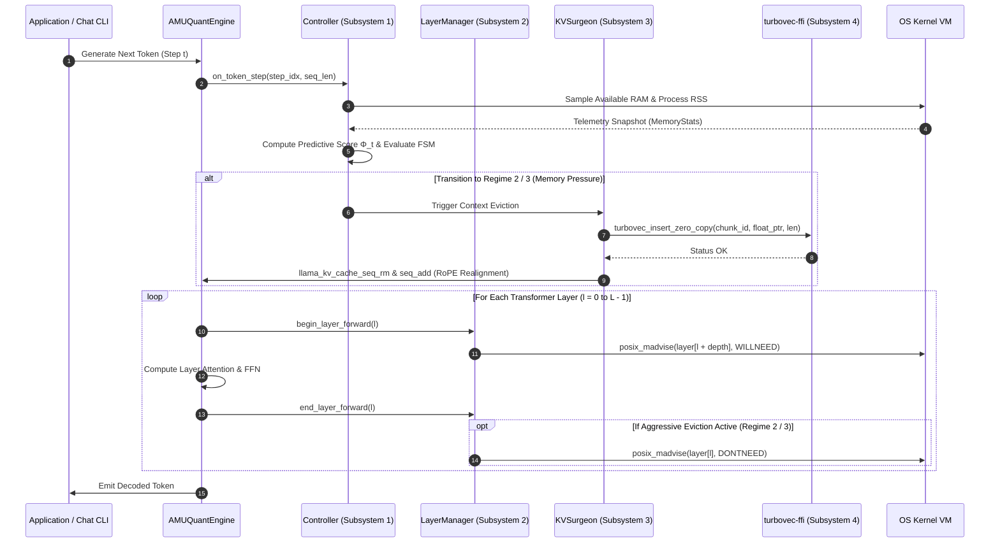

# AMU-QUANT System Architecture

This document presents the in-depth technical architecture of **AMU-QUANT**, a co-adaptive runtime engine bridging active layer-wise weight streaming on `llama.cpp` with in-memory vector compression via `turbovec`.

---

## 1. High-Level Architecture Overview

AMU-QUANT consists of four integrated subsystems executing entirely in-process in native C++17 and Rust without external Python runtime overhead:

```mermaid
flowchart TB
    subgraph Host_OS ["Operating System Kernel & Virtual Memory Layer"]
        ProcMem["/proc/meminfo / mach_vm_info (RAM & Swap Telemetry)"]
        KernelMadvise["Kernel Directives: posix_madvise / VirtualUnlock API"]
        GGUF_File[".gguf Weight File on NVMe SSD (Single File)"]
    end

    subgraph AMU-QUANT_Core ["AMU-QUANT Core Engine (C++17)"]
        subgraph Mem_Controller ["Subsystem 1: Dual-Budget Adaptive Controller"]
            OS_Sampler["OS Memory Telemetry Sampler (K-token stride)"]
            PredictiveEngine["Predictive Memory Pressure Estimator (Φ_t)"]
            RegimeStateMachine["Adaptive Finite State Machine (Hysteresis)"]
        end

        subgraph Layer_Manager ["Subsystem 2: Active Layer-wise mmap Manager"]
            LayerRegistry["Layer Address Space Registry (llama_model)"]
            EvictionQueue["Page Eviction Queue (POSIX_MADV_DONTNEED)"]
            PrefetchPipeline["Asynchronous Prefetcher (POSIX_MADV_WILLNEED)"]
        end

        subgraph KV_Manager ["Subsystem 3: Dynamic KV-Cache Surgery Engine"]
            AttentionTracker["Attention Sink & Recency Window Tracker"]
            KVSurgeon["KV Surgery Controller: seq_rm & seq_add"]
            ContextBuffer["Active KV Working Set (llama_context)"]
        end
    end

    subgraph Turbovec_Engine ["Subsystem 4: turbovec Episodic Memory (Rust FFI)"]
        C_ABI_Bridge["turbovec-ffi Bridge (Zero-Copy Raw Pointer Interface)"]
        TurboIndex["TurboQuant Index (Lloyd-Max 4-bit / 2-bit Compressed)"]
        SIMD_Search["AVX2 / AVX-512 / ARM NEON Search Engine"]
        ContextRestorer["Selective Context Unpacker & Restorer"]
    end

    %% Telemetry & Control Flows
    ProcMem -->|RSS, Free RAM, Swap Rate| OS_Sampler
    OS_Sampler --> PredictiveEngine
    PredictiveEngine --> RegimeStateMachine
    RegimeStateMachine -->|Set Sliding Window & Prefetch Depth| Layer_Manager
    RegimeStateMachine -->|Trigger Pruning & Compression Mode| KV_Manager

    %% Layer Manager & OS Kernel
    GGUF_File -->|mmap read-only| LayerRegistry
    Layer_Manager -->|Issue Evict / Prefetch Directives| KernelMadvise
    KernelMadvise -.->|Release Page Cache / Fault Pages In| GGUF_File

    %% KV Surgery & turbovec FFI
    KVSurgeon -->|Pruned Token Embeddings (Raw Pointer Passing)| C_ABI_Bridge
    C_ABI_Bridge --> TurboIndex
    TurboIndex -->|Requantize 4-bit -> 2-bit on Critical Pressure| TurboIndex

    %% Context Recall
    SIMD_Search -->|Top-K Matching Chunk IDs & Cosine Scores| ContextRestorer
    ContextRestorer -->|Selective Context Injection| ContextBuffer
    ContextBuffer --> KVSurgeon
```

---

## 2. Core Subsystems Specification

### 2.1 Subsystem 1: Dual-Budget Adaptive Controller
The controller operates as the central arbiter, evaluated synchronously every $K$ generated tokens ($K \in [4, 16]$) or asynchronously on a dedicated sampling thread.

* **Key Responsibilities:**
  1. Gathers instantaneous OS memory telemetry: Available RAM, process physical footprint (RSS), and swap activity.
  2. Evaluates the Predictive Pressure Score $\Phi_t$, which accounts for both instantaneous saturation and differential expansion rate $\frac{\Delta M}{\Delta t}$.
  3. Transitions between three operational modes: **Regime 1 (High-Throughput)**, **Regime 2 (Balanced Offload)**, or **Regime 3 (Ultra-Low Survival)**.
  4. Enforces a hysteresis guard band ($\delta_{\text{hyst}}$) to prevent flapping (rapid oscillation between page eviction and prefetching).

### 2.2 Subsystem 2: Active Layer-wise mmap Manager
Unlike naive disk-splitting architectures that fragment weight files into dozens of separate partitions on disk, AMU-QUANT operates directly on a single, unmodified `.gguf` file mapped into virtual memory address space via `mmap()`.

* **Operational Mechanics:**
  * **Layer Registration:** During initialization, AMU-QUANT parses the model layout to map the starting and ending memory offsets (`addr_start`, `byte_len`) of every transformer layer ($l = 0, 1, \dots, L-1$).
  * **Proactive Eviction:** Immediately upon completion of the forward pass for layer $l$, the manager issues:
    ```c
    posix_madvise(layer[l].addr_start, layer[l].byte_len, POSIX_MADV_DONTNEED);
    ```
    This notifies the Darwin/Linux virtual memory manager that the underlying physical pages can be immediately reclaimed from the OS page cache without writeback penalties.
  * **Asynchronous Prefetching:** When memory headroom permits (Regime 1 & 2), before layer $l$ begins execution, the manager dispatches read-ahead advisories for upcoming layers ($l + 1, \dots, l + \text{depth}$):
    ```c
    posix_madvise(layer[l + 1].addr_start, layer[l + 1].byte_len, POSIX_MADV_WILLNEED);
    ```
    On Windows systems, the equivalent native Win32 calls `PrefetchVirtualMemory()` and `VirtualUnlock()` are utilized.

### 2.3 Subsystem 3: Dynamic KV-Cache Surgery Engine
During extended multi-turn dialogs and multi-step reasoning, physical KV-cache memory expands linearly. AMU-QUANT partitions the active KV sequence into three distinct functional zones:

1. **Attention Sinks ($W_{\text{sink}}$):** The initial 4 tokens (tokens 0 to 3) are permanently preserved in the physical KV-cache to maintain softmax normalization stability (following the attention sink phenomenon).
2. **Active Working Window ($W_{\text{recent}}$):** The most recent $N_{\text{recent}}$ tokens serving as the immediate autoregressive receptive field.
3. **Eviction Candidate Window ($W_{\text{middle}}$):** The tokens situated between the attention sinks and the recent window ($p \in [W_{\text{sink}}, T - W_{\text{recent}}]$).

* **KV Surgery Mechanics:**
  * Candidate tokens are extracted as contiguous float vectors and passed directly into the `turbovec` index via raw memory pointers (*zero-copy*).
  * The sequence slot range is excised from physical KV memory using `llama_kv_cache_seq_rm(ctx, 0, p_start, p_end)`.
  * Position indices of all subsequent tokens are shifted using `llama_kv_cache_seq_add(ctx, 0, p_end, -1, delta)` to maintain mathematical continuity for Rotary Position Embedding (RoPE).

### 2.4 Subsystem 4: turbovec In-Process Vector Index (Rust C-ABI)
Employs an embedded, thread-safe instance of the Google Research TurboQuant algorithm implemented in Rust:

* **Lloyd-Max Scalar Quantization:** Rotates incoming token vectors with a deterministic block-orthogonal matrix $\mathbf{Q} \in \mathbb{R}^{B \times B}$ ($B=64$) and discretizes components to precomputed Lloyd-Max codebooks (4-bit: 16 levels, 2-bit: 4 levels).
* **SIMD-Accelerated Cosine Retrieval:** Decodes quantized vector blocks in CPU vector registers (ARM NEON or AVX2/AVX-512) to compute Top-$K$ cosine similarity queries in sub-millisecond latency (<0.25 ms).
* **In-Place Requantization:** Under critical memory pressure (Regime 3), the index performs a direct bit-shift pass over all stored 4-bit nibbles, condensing them to 2-bit dibits in-place without reallocation.

---

## 3. Autoregressive Execution Lifecycle

The diagram below illustrates the exact execution lifecycle for generating a single token under AMU-QUANT orchestration:



---

## 4. Zero-Copy Pointer Passing & Memory Safety

To eliminate serialization overhead between C++ and Rust, AMU-QUANT adheres to strict zero-copy invariants across the foreign function boundary:

```c
// C++ callers pass raw pointers to existing contiguous float arrays
TurbovecStatus turbovec_insert_zero_copy(
    TurbovecIndexHandle* handle,
    uint64_t chunk_id,
    const float* float_ptr,
    size_t len
);
```

### Invariants:
1. **No Intermediate Buffer Copies:** Rust creates a transient, read-only slice (`std::slice::from_raw_parts(float_ptr, len)`) directly mapping C++ memory for immediate vector rotation and quantization into its own compact index structure.
2. **Panic Boundary Protection:** Every exported Rust C-ABI symbol is wrapped in `std::panic::catch_unwind(|| { ... })`. Any unhandled panic is intercepted at the FFI boundary and converted into a standard C enum status code (`TURBOVEC_ERR_PANIC_CAUGHT`), preventing undefined unwinding across foreign stack frames.
3. **Thread Safety:** The Rust handle wraps the vector index in an `std::sync::RwLock`, permitting concurrent multi-threaded SIMD queries while synchronizing rare insertion and requantization operations.
