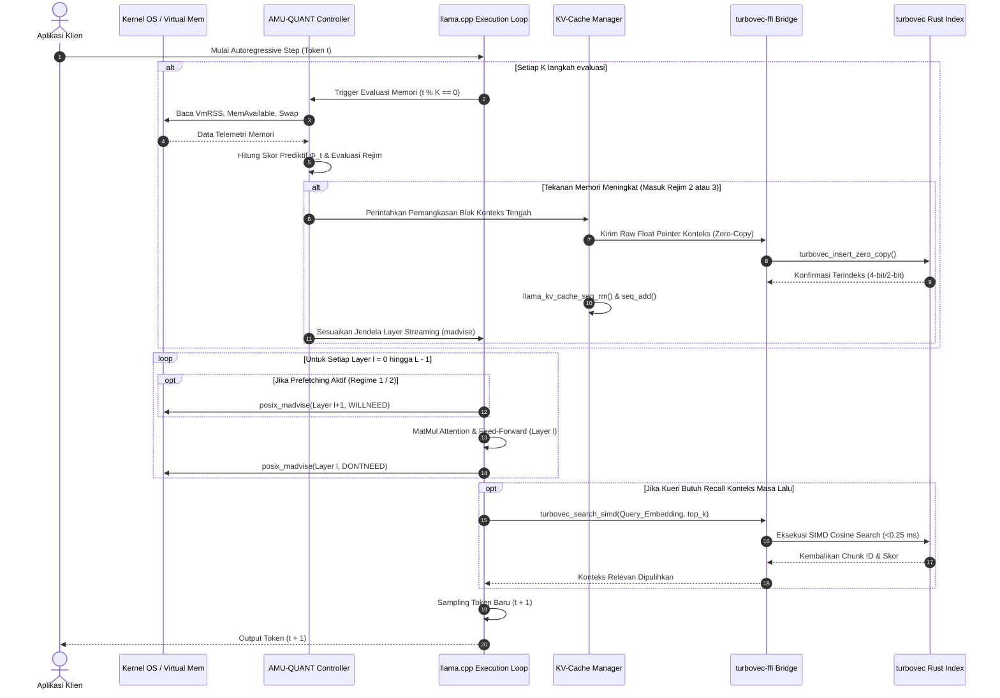

# ARSITEKTUR SISTEM AMU-QUANT

Dokumen ini memaparkan rancangan teknis (*technical architecture*) mendalam dari sistem **AMU-QUANT**, sebuah mesin inferensi ko-adaptif yang menghubungkan *layer-wise weight streaming* pada `llama.cpp` dengan *in-memory vector compression* menggunakan `turbovec`.

---

## 1. Gambaran Arsitektur Tingkat Tinggi (High-Level Overview)

AMU-QUANT terdiri dari empat subsistem terintegrasi yang bekerja dalam satu proses (*in-process*) native tanpa runtime Python:

```mermaid
flowchart TB
    subgraph Host_OS ["Lapisan Kernel & Virtual Memory OS"]
        ProcMem["/proc/meminfo / mach_vm_info (RAM & Swap Telemetry)"]
        KernelMadvise["posix_madvise / VirtualUnlock API"]
        GGUF_File["File Model .gguf pada NVMe SSD (Single File)"]
    end

    subgraph AMU-QUANT_Core ["AMU-QUANT Core Engine (C++17)"]
        subgraph Mem_Controller ["Subsistem 1: Dual-Budget Adaptive Controller"]
            OS_Sampler["OS Memory Telemetry Sampler (Interval K token)"]
            PredictiveEngine["Predictive Memory Pressure Calculator (Φ_t)"]
            RegimeStateMachine["Adaptive Regime State Machine (Hysteresis)"]
        end

        subgraph Layer_Manager ["Subsistem 2: Active Layer-wise mmap Manager"]
            LayerRegistry["Layer Address Space Registry (llama_model)"]
            EvictionQueue["Page Eviction Queue (POSIX_MADV_DONTNEED)"]
            PrefetchPipeline["Asynchronous Prefetcher (POSIX_MADV_WILLNEED)"]
        end

        subgraph KV_Manager ["Subsistem 3: Dynamic KV-Cache Surgery Engine"]
            AttentionTracker["Attention Sink & Recency Window Tracker"]
            KVSurgeon["KV Surgery Controller: seq_rm & seq_add"]
            ContextBuffer["Active KV Working Set (llama_context)"]
        end
    end

    subgraph Turbovec_Engine ["Subsistem 4: turbovec Episodic Memory (Rust FFI)"]
        C_ABI_Bridge["turbovec-ffi Bridge (Zero-Copy Pointer Interface)"]
        TurboIndex["TurboQuant Index (Lloyd-Max 4-bit / 2-bit Compressed)"]
        SIMD_Search["AVX2 / AVX-512 / ARM NEON Search Engine"]
        ContextRestorer["Selective Context Unpacker & Restorer"]
    end

    %% Hubungan Telemetri & Kontrol
    ProcMem -->|RSS, Free RAM, Swap Rate| OS_Sampler
    OS_Sampler --> PredictiveEngine
    PredictiveEngine --> RegimeStateMachine
    RegimeStateMachine -->|Set Sliding Window & Prefetch Depth| Layer_Manager
    RegimeStateMachine -->|Trigger Pruning & Compression Mode| KV_Manager

    %% Hubungan Layer Manager dengan OS
    GGUF_File -->|mmap read-only| LayerRegistry
    Layer_Manager -->|Kirim Perintah Evict / Prefetch Halaman| KernelMadvise
    KernelMadvise -.->|Bebaskan Page Cache / Tarik Halaman| GGUF_File

    %% Hubungan KV Manager dengan turbovec FFI
    KVSurgeon -->|Ekstraksi Tensor Token Terpangkas (Pointer Mentah)| C_ABI_Bridge
    C_ABI_Bridge --> TurboIndex
    TurboIndex -->|Turunkan Bit (Saat Krisis Memori)| TurboIndex

    %% Hubungan Pemulihan Konteks
    SIMD_Search -->|Top-K Context Chunks| ContextRestorer
    ContextRestorer -->|Injeksi Balik ke Working Set| ContextBuffer
    ContextBuffer --> KVSurgeon
```

---

## 2. Rincian Subsistem Inti

### 2.1 Subsistem 1: Dual-Budget Adaptive Controller
Pengontrol memori bertindak sebagai otak orkestrasi yang berjalan di *background thread* atau dievaluasi secara tersinkronisasi setiap $K$ langkah generasi token ($K \in [4, 16]$).
* **Fungsi Utama:**
  1. Mengumpulkan telemetri memori sistem: *Available Memory*, *Resident Set Size* (RSS) proses, dan laju komparatif *Swap In/Out*.
  2. Menghitung Skor Tekanan Memori Prediktif $\Phi_t$ yang mempertimbangkan laju perubahan $\frac{\Delta M}{\Delta t}$.
  3. Memilih salah satu dari 3 rejim operasi: **Regime 1 (High-Throughput)**, **Regime 2 (Balanced Offload)**, atau **Regime 3 (Ultra-Low Survival)**.
  4. Menerapkan kontrol histeresis guna mencegah osilasi pelepasan/pemuatan halaman secara berulang-ulang (*flapping*).

### 2.2 Subsistem 2: Active Layer-wise mmap Manager
Berbeda dari AirLLM yang memecah file bobot menjadi lusinan file terpisah di disk, AMU-QUANT bekerja pada file `.gguf` tunggal yang dipetakan ke alamat memori virtual melalui `mmap`.
* **Mekanisme Kerja:**
  * Saat inisialisasi, AMU-QUANT menginspeksi struktur internal `llama_model` untuk memetakan rentang alamat memori virtual awal (`addr_start`) dan akhir (`addr_end`) dari setiap layer transformator ($l = 0, 1, \dots, L-1$).
  * **Proactive Eviction:** Segera setelah komputasi maju (*forward pass*) pada layer $l$ selesai, layer manager memanggil:
    ```c
    posix_madvise(layer[l].addr_start, layer[l].byte_len, POSIX_MADV_DONTNEED);
    ```
    Instruksi ini memberi tahu kernel Linux/macOS bahwa halaman-halaman memori fisik milik layer tersebut dapat segera dibebaskan dari *page cache*.
  * **Asynchronous Prefetching:** Jika anggaran RAM memungkinkan (Regime 1 & 2), sebelum komputasi layer $l$ dimulai, layer manager mengirimkan sinyal awal untuk layer $l + 1$ atau $l + 2$:
    ```c
    posix_madvise(layer[l + 1].addr_start, layer[l + 1].byte_len, POSIX_MADV_WILLNEED);
    ```
    Pada sistem operasi Windows, fungsi padanan yang digunakan adalah `PrefetchVirtualMemory()` dan `VirtualUnlock()`.

### 2.3 Subsistem 3: Dynamic KV-Cache Surgery Engine
Ketika konteks percakapan membesar, KV-cache menjadi komponen yang menguras memori secara cepat. AMU-QUANT membagi KV-cache menjadi tiga zona fungsional:
1. **Attention Sinks ($W_{\text{sink}}$):** Token awal (token 0 hingga 3) dipertahankan secara absolut di KV-cache fisik untuk menjaga kestabilan nilai *softmax attention* (berdasarkan temuan StreamingLLM).
2. **Active Working Window ($W_{\text{recent}}$):** Jendela token paling baru ($N_{\text{recent}}$ token) yang menjadi konteks perhatian lokal autoregresif.
3. **Eviction Candidate Window ($W_{\text{middle}}$):** Token-token di antara *sinks* dan *recent window*.

```
Index Posisi Konteks:
[0 ... 3]        [4 ............................... t - N_recent - 1]     [t - N_recent ... t]
└───┬───┘        └───────────────────────┬──────────────────────────┘     └─────────┬────────┘
 Attention Sinks           Eviction Candidates (Dipangkas)                  Recent Window
 (Dipertahankan)           (Diarsipkan ke turbovec via FFI)                 (Dipertahankan)
```

* **Operasi Pemotongan dan Perapatan (*Surgery*):**
  AMU-QUANT memanfaatkan API resmi dari `llama.h`:
  ```cpp
  // 1. Hapus range token tengah dari KV cache fisik
  llama_kv_cache_seq_rm(ctx, /*seq_id=*/0, /*p0=*/p_start, /*p1=*/p_end);

  // 2. Rapatkan kembali offset posisi RoPE agar tidak terjadi celah indeks
  int32_t shift_delta = -(p_end - p_start);
  llama_kv_cache_seq_add(ctx, /*seq_id=*/0, /*p0=*/p_end, /*p1=*/-1, shift_delta);
  ```

### 2.4 Subsistem 4: turbovec Episodic Memory (Rust FFI Bridge)
Sebelum token tengah dipotong pada Subsistem 3, representasi tensor token tersebut diekstraksi dan dikirimkan ke modul Rust `turbovec` melalui jembatan C-ABI.
* **Proses Kompresi TurboQuant:**
  * Tensor vektor berdimensi $d$ (misal $d = 4096$) dikalikan dengan matriks rotasi ortogonal acak (*Random Orthogonal Matrix* $\mathbf{Q} \in \mathbb{R}^{d \times d}$).
  * Vektor terotasi memiliki distribusi komponen independen dan terdistribusi identik (i.i.d.) Gaussian $\mathcal{N}(0, 1/d)$.
  * Diterapkan kuantisasi skalar Lloyd-Max 4-bit (16 level representasi) atau 2-bit (4 level representasi).
  * Menghasilkan penghematan memori sebesar 7,8x (mode 4-bit) hingga 15,5x (mode 2-bit) dibandingkan format FP16.
* **SIMD Fast Search & Recall:**
  * Ketika model menghadapi token kueri yang memerlukan rujukan masa lalu (*needle retrieval*), vektor representasi kueri dikirim ke fungsi `turbovec_search_simd`.
  * Dalam waktu $<0{,}25\text{ ms}$, indeks mengembalikan $k$ ID potongan konteks paling relevan.
  * Token-token terpilih didekompresi dan disuntikkan kembali ke dalam *working set* KV-cache.

---

## 3. Diagram Sekuensial Autoregressive Decoding Loop

Diagram berikut menggambarkan interaksi antarkomponen pada setiap iterasi pembuatan token:



---

## 4. Alur Pertukaran Memori Zero-Copy (Memory Ownership Model)

Salah satu keunggulan teknis AMU-QUANT adalah penghindaran *overhead* alokasi dan penyalinan memori yang sering menjadi penghambat pada bahasa dengan *garbage collection* seperti Python.

```
+-------------------------------------------------------------------------------+
| RAM Fisik (Host C++ / llama.cpp Context)                                     |
|                                                                               |
|  llama_context                                                                |
|  +-------------------------------------------------------------------------+  |
|  | KV Cache Memory Buffer: Float Pointer: 0x7FFF12340000                   |  |
|  | [ Token 0 ][ Token 1 ] ... [ Token p_start ... p_end ] ... [ Token t ]  |  |
|  +-------------------------------------------------------------------------+  |
+---------------------------------------|---------------------------------------+
                                        | Pengiriman Alamat Pointer Mentah
                                        | (Zero-Copy Passing via C-ABI)
                                        v
+-------------------------------------------------------------------------------+
| Memori Rust (turbovec Index Crate)                                            |
|                                                                               |
|  turbovec_insert_zero_copy(index, chunk_id, ptr, len)                         |
|  +-------------------------------------------------------------------------+  |
|  | 1. Membaca slice &[f32] langsung dari alamat pointer 0x7FFF12340000     |  |
|  | 2. Menjalankan Orthogonal Matrix Rotation via SIMD registers             |  |
|  | 3. Mengemas representasi ke quantized buffer (Mode 4-bit / 2-bit)       |  |
|  | 4. Menyimpan bit-packed array di turbovec In-Memory Index               |  |
|  +-------------------------------------------------------------------------+  |
|                                                                               |
|  Hasil: Hanya bit-packed quantized array yang dialokasikan di Rust (~1/15.5x) |
+-------------------------------------------------------------------------------+
```

### Aturan Kepemilikan (*Ownership Rules*):
1. **Host C++** memegang kepemilikan mutlak atas buffer asli tensor `llama_context`.
2. **Jembatan FFI Rust** meminjam (*borrows*) pointer C++ tersebut sebagai slice read-only `unsafe { std::slice::from_raw_parts(ptr, len) }` hanya selama durasi fungsi kuantisasi berjalan.
3. Struktur terkompresi yang dihasilkan (*quantized bit-packed vectors*) disimpan secara mandiri di dalam heap Rust (`Box<TurboIndex>`) yang ditunjuk oleh pointer buram (*opaque pointer*) `*mut TurbovecIndex`.
4. Pembebasan memori indeks dilakukan secara eksplisit melalui fungsi penutup `turbovec_free(index)` untuk menjamin tidak terjadinya kebocoran memori (*memory leak*).

---

## 5. Keamanan Thread & Penanganan Pengecualian (*Exception Safety*)

* **Reentrancy & Thread Safety:**  
  Struktur `TurbovecIndex` di dalam Rust dibungkus dalam mekanisme sinkronisasi yang aman (atau diakses secara sekuensial oleh alur inferensi utama).
* **Panic Isolation:**  
  Fungsi-fungsi yang diekspos melalui C-ABI di sisi Rust dilindungi dengan macro `std::panic::catch_unwind`. Hal ini mencegah terjadinya *stack unwinding* yang melintasi batas ABI Rust-C++, yang merupakan salah satu penyebab utama *crash segmentation fault* pada integrasi multi-bahasa.
* **Return Code Convention:**  
  Setiap fungsi FFI mengembalikan tipe enumerasi `TurbovecStatus`:
  * `TURBOVEC_OK = 0`: Eksekusi berhasil.
  * `TURBOVEC_ERR_NULL_POINTER = -1`: Pointer yang diberikan bernilai `nullptr`.
  * `TURBOVEC_ERR_INVALID_PARAM = -2`: Parameter dimensi atau bit-width tidak valid.
  * `TURBOVEC_ERR_PANIC = -3`: Terjadi panic internal di dalam runtime Rust yang tertangkap secara aman.
