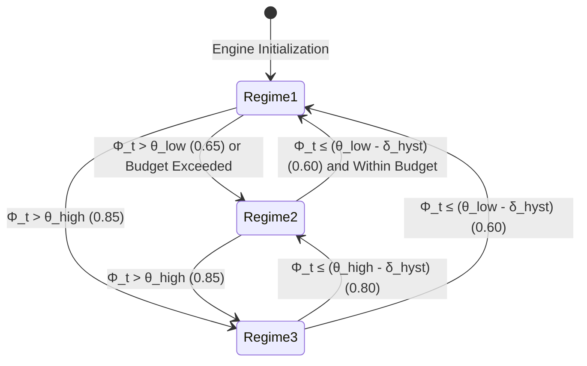

# Mathematical Model and Co-Adaptive Controller

This document presents the mathematical formalization of the dual-budget memory equilibrium, the predictive cost-benefit controller, and the rotary position embedding (RoPE) continuity theorem of **AMU-QUANT**.

---

## 1. Dual-Budget Memory Equilibrium Formulation

On resource-constrained host machines with a safe physical RAM ceiling $M_{\text{limit}}$, total physical memory allocation (*Resident Set Size* / RSS) at autoregressive generation step $t$ is modeled by the following equilibrium inequality:

$$\underbrace{M_{\text{ext}}(t)}_{\text{OS Kernel and External Apps}} + \underbrace{\sum_{l \in \mathcal{L}_{\text{resident}}(t)} M_{\text{weight}}(l)}_{\text{Resident Weight Pages in RAM}} + \underbrace{M_{\text{KV}}(W_t)}_{\text{Active Physical KV-Cache}} + \underbrace{M_{\text{history}}(H_t)}_{\text{Canonical History Text Store}} \le M_{\text{limit}}$$

### Variable Definitions:
* **$M_{\text{limit}}$**: Safe physical RAM ceiling allocated for the process:
  $$M_{\text{limit}} = M_{\text{RAM}} - M_{\text{reserved}}$$
  (For example, on a 16 GB host, $M_{\text{limit}} \approx 14.0\text{ GB}$ with $2.0\text{ GB}$ reserved for OS stability; on an 8 GB host, $M_{\text{limit}} \approx 6.8\text{ GB}$ with $1.2\text{ GB}$ reserved).
* **$M_{\text{ext}}(t)$**: Physical memory consumed by external system processes (e.g. browser, code editor, background daemons).
* **$\mathcal{L}_{\text{resident}}(t) \subseteq \{0, 1, \dots, L-1\}$**: The set of transformer layer indices whose weight pages currently reside in physical RAM via `mmap()`.
* **$M_{\text{weight}}(l)$**: Memory footprint of a single transformer layer $l$:
  $$M_{\text{weight}}(l) \approx \frac{M_{\text{model}}}{L}$$
* **$W_t$**: The count of active physical tokens held in the FP16 KV-cache memory in `llama.cpp` at step $t$:
  $$M_{\text{KV}}(W_t) = 2 \times L \times n_{\text{kv}} \times d_{\text{head}} \times 2 \times W_t$$
  By enforcing a proactive working-set constraint $\Omega_{\text{target}}$, AMU-QUANT bounds $W_t \le \Omega_{\text{target}}$ ($O(1)$ constant), preventing linear expansion.
* **$H_t$**: The count of historical conversation turns stored verbatim in `CanonicalHistoryStore`. Since text characters require only $\approx 1\text{--}2\text{ bytes/char}$, $M_{\text{history}}(H_t) \ll M_{\text{KV}}(W_t)$ ($< 150\text{ KB}$ for 100 conversational turns), introducing negligible memory overhead compared to active attention tensors.

---

## 2. Predictive Memory Pressure Metric ($\Phi_t$)

To prevent delayed control reactions that would otherwise trigger termination by the OS kernel OOM Killer, AMU-QUANT formulates a **Hybrid Predictive Memory Pressure Metric ($\Phi_t$)** evaluated every $K$ tokens. It integrates internal process memory utilization with host system available RAM capacity and swap thrashing:

$$\Phi_t = \max\left(\mathcal{U}_{\text{process}}(t),\, \mathcal{U}_{\text{system}}(t)\right) + \beta \cdot \mathcal{P}_{\text{growth}}(t) + \gamma \cdot \mathcal{P}_{\text{swap}}(t)$$

Where:
* **Process Saturation Ratio**:
  $$\mathcal{U}_{\text{process}}(t) = \frac{M_{\text{process}}(t)}{M_{\text{limit}}}$$
* **System Saturation Ratio**:
  $$\mathcal{U}_{\text{system}}(t) = \frac{M_{\text{total}} - M_{\text{available}}(t)}{M_{\text{total}} - M_{\text{reserved}}}$$
* **Projected Differential Growth Penalty**:
  $$\mathcal{P}_{\text{growth}}(t) = \min\left(1.0, \max\left(0.0, \frac{1}{M_{\text{limit}}} \frac{\Delta M_{\text{process}}}{\Delta t} \tau_{\text{horizon}}\right)\right)$$
* **Kernel Swap Thrashing Penalty**:
  $$\mathcal{P}_{\text{swap}}(t) = \min\left(1.0, \frac{M_{\text{swap}}(t)}{1.0\text{ GB}}\right)$$
* **Lookahead Time Horizon**: $\tau_{\text{horizon}} = 2.0\text{ seconds}$.
* **Nominal Calibration Weights**: $\beta = 0.25$ and $\gamma = 0.15$.

---

## 3. Multi-Action Cost-Benefit Utility Formulation ($J(a)$)

In the default predictive mode (`ArbitrationPolicy::PREDICTIVE_COST_BENEFIT`), the controller selects the candidate operational regime $a \in \{\text{Regime 1}, \text{Regime 2}, \text{Regime 3}\}$ that minimizes a composite cost objective:

$$J(a) = \text{OOM\_Risk}(a) + P_{\text{bloat}}(a) + \lambda_{\text{lat}} \cdot L(a) + \lambda_{\text{qual}} \cdot Q(a)$$

Where:
* **$\text{OOM\_Risk}(a)$**: Proportional penalty when projected memory exceeds safe thresholds:
  $$\text{OOM\_Risk}(a) = w_{\text{risk}} \cdot \frac{\max\left(0,\, M_{\text{projected}}(a) - M_{\text{safe}}\right)}{M_{\text{safe}}}$$
* **$P_{\text{bloat}}(a)$**: Proactive working-set budget constraint:
  $$P_{\text{bloat}}(a) = w_{\text{bloat}} \cdot \max\left(0, \frac{|KV_{\text{retained}}(a)| - \Omega_{\text{target}}}{\Omega_{\text{target}}}\right)$$
  When active KV slots exceed the budget target $\Omega_{\text{target}}$ ($\approx 96\text{ slots}$), this penalty encourages Regime 2 transition even under comfortable host RAM.
* **$L(a)$**: Adaptation latency overhead ($L(\text{Regime 1}) = 0$, $L(\text{Regime 2}) = 0.02$, $L(\text{Regime 3}) = 0.08$).
* **$Q(a)$**: Context reduction quality loss factor ($Q(\text{Regime 1}) = 0$, $Q(\text{Regime 2}) = 0.05$, $Q(\text{Regime 3}) = 0.10$).

---

## 4. Tri-Modal Regime Arbitration & Hysteresis State Machine



### Regime Specifications:

| Regime | Condition | Prefetch Depth | Aggressive Page Eviction | Physical KV Window | Working-Set Target |
|:---|:---|:---:|:---:|:---|:---|
| **Regime 1: High-Throughput** | Low pressure ($\Phi_t \le 0.65$) | 3 Layers | Disabled (`DONTNEED` deferred) | Full sequence retained | Unconstrained |
| **Regime 2: Balanced Offload** | Moderate ($\Phi_t > 0.65$ or $|KV| > \Omega_{\text{target}}$) | 1 Layer | Enabled (Immediate `DONTNEED`) | Sinks + Recent Window | Bounded ($\le 96\text{ slots}$) |
| **Regime 3: Ultra-Low Survival** | Critical ($\Phi_t > 0.85$ or Host Starvation) | 0 (Strict single layer) | Enabled (Immediate `DONTNEED`) | Sinks + Clamped Min Window ($W_{\text{min}} = 24$) | Emergency ($\le 72\text{ slots}$) |

### Hysteresis Guard Band:
Demotions to lower pressure regimes require the pressure score to drop below the threshold minus a hysteresis margin $\delta_{\text{hyst}} = 0.05$:
* Demotion from Regime 3 to Regime 2 requires $\Phi_t \le \theta_{\text{high}} - \delta_{\text{hyst}} = 0.80$.
* Demotion from Regime 2 to Regime 1 requires $\Phi_t \le \theta_{\text{low}} - \delta_{\text{hyst}} = 0.60$.

---

## 5. Rotary Position Embedding (RoPE) Mathematical Continuity

When the candidate sequence range $[p_{\text{start}}, p_{\text{end}})$ is excised from the physical KV-cache, an index void of width $\Delta_{\text{gap}} = p_{\text{end}} - p_{\text{start}}$ is created. In standard autoregressive attention, the rotary positional matrix is computed as:

$$\mathbf{R}_{\Theta, m} = \text{diag}\left( \mathbf{R}_{\theta_1, m}, \dots, \mathbf{R}_{\theta_{d/2}, m} \right), \quad \text{where } \mathbf{R}_{\theta, m} = \begin{pmatrix} \cos(m\theta) & -\sin(m\theta) \\ \sin(m\theta) & \cos(m\theta) \end{pmatrix}$$

If token positions remain unadjusted, subsequent tokens at position $m \ge p_{\text{end}}$ encounter an artificial positional discontinuity, degrading perplexity. 

AMU-QUANT applies a linear positional translation to all subsequent active tokens:

$$m_{\text{new}} = m_{\text{old}} - \Delta_{\text{gap}}, \quad \forall m \ge p_{\text{end}}$$

Via the low-level API call:
```cpp
llama_memory_seq_add(mem, 0, p_end, -1, -static_cast<int32_t>(delta_gap));
```
This guarantees that query and key embeddings maintain smooth, contiguous relative distances $|m - n|$ across the excised boundary.

---

## 6. Algorithmic Scheduling Logic

```text
Algorithm: AMU-QUANT Co-Adaptive Step Arbitration
Input: token_step t, current_seq_len T, config CFG, telemetry TEL, layer_mgr LM, kv_surgeon KV
Output: StepDecision DEC

1: if (t % CFG.eval_interval_tokens != 0) then
2:     return CachedDecision
3: end if
4:
5: stats <- TEL.sample()
6: elapsed_time <- max(stats.timestamp_sec - last_eval_time, 0.05)
7: delta_rss <- stats.process_rss_bytes - last_eval_rss
8:
9: phi <- compute_phi_score(stats, elapsed_time, delta_rss, CFG)
10: optimal_regime <- arbitrate_predictive_cost_benefit(stats, elapsed_time, delta_rss, T, CFG)
11:
12: if optimal_regime == REGIME_2 then
13:     range <- KV.plan_eviction(T, CFG.attention_sinks, eff_recent_window(CFG))
14:     if range.valid then KV.execute_eviction(range, seq_rm, seq_add)
15: else if optimal_regime == REGIME_3 then
16:     range <- KV.plan_eviction(T, CFG.attention_sinks, CFG.min_recent_window)
17:     if range.valid then KV.execute_eviction(range, seq_rm, seq_add)
18: end if
19:
20: return UpdatedDecision
```

---

## 7. Reliable Semantic Memory & Grounding Guardrail Model

To prevent memory degradation, factual knowledge clash, and ungrounded hallucinations when operating under physical KV-cache pruning, AMU-QUANT formalizes a **Reliable Semantic Memory Model**:

### 7.1 Temporal Fact State Space & Transition Rules

Let $\mathcal{F}$ denote the set of extracted factual slot-value pairs $(k, v, t_{\text{origin}})$ where $k$ is the normalized entity key, $v$ is the assigned value, and $t_{\text{origin}}$ is the dialogue turn of origin. Each fact slot transitions within a deterministic state space:

$$S_{\text{fact}}(k, v) \in \{\text{ACTIVE}, \text{SUPERSEDED}, \text{CONTRADICTED}\}$$

When a new fact assertion $(k, v', t_{\text{new}})$ occurs at turn $t_{\text{new}} > t_{\text{origin}}$:

$$\forall (k, v, t_{\text{origin}}) \in \mathcal{F}_{\text{active}}: \quad v' \neq v \implies \begin{cases} S_{\text{fact}}(k, v) \leftarrow \text{SUPERSEDED} \ (\text{with } t_{\text{superseded}} = t_{\text{new}}) \\ S_{\text{fact}}(k, v') \leftarrow \text{ACTIVE} \end{cases}$$

This invariant guarantees that stale historical facts are never injected into context as active truth.

### 7.2 Evidence Threshold ($\tau_{\text{evidence}}$) and Calibrated Abstention

Given a user query $q$, the semantic memory retriever computes an evidence relevance score $S_{\text{rel}}(q) \in [0, 1]$ across active factual slots and dialogue history:

$$S_{\text{rel}}(q) = \max\left( \max_{f \in \mathcal{F}_{\text{active}}} \text{OverlapRatio}(q, \text{Key}(f)),\, \max_{t \in \mathcal{H}} \text{LexicalScore}(q, t) \right)$$

The engine applies a dual-threshold decision rule parameterized by $\tau_{\text{evidence}} = 0.25$:

$$\text{PromptAction}(q) = \begin{cases} \text{InjectActiveGroundedFacts}(q, \mathcal{F}_{\text{matched}}, \text{Provenance}) & \text{if } S_{\text{rel}}(q) \ge \tau_{\text{evidence}} \\ \text{InjectAbstentionDirective}(q, \text{StrictRefusal}) & \text{if } S_{\text{rel}}(q) < \tau_{\text{evidence}} \end{cases}$$

Where the abstention directive strictly mandates that the model acknowledge insufficient evidence rather than guessing, driving hallucination rates on ungrounded inquiries to $0.0\%$.
