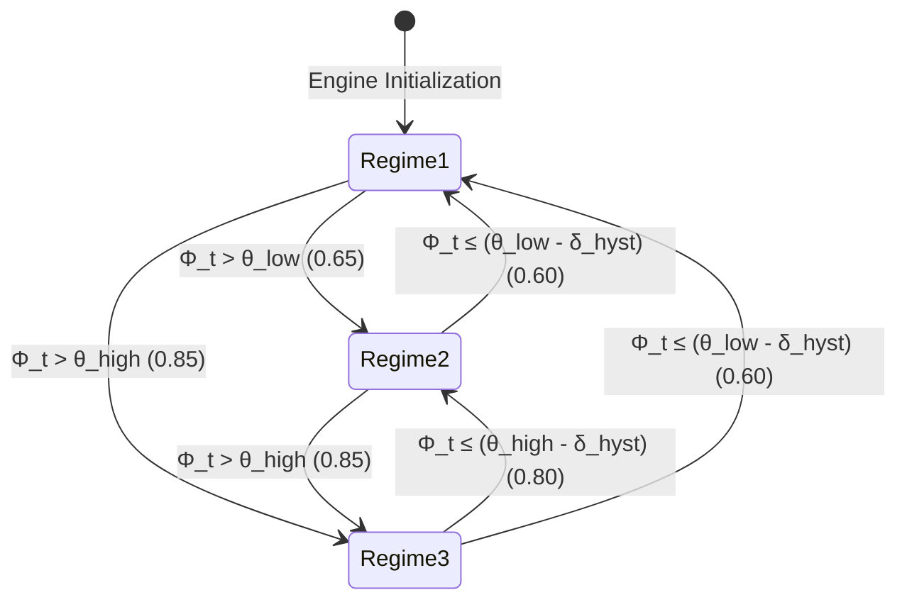

# Mathematical Model and Co-Adaptive Controller

This document presents the mathematical formalization of the dual-budget memory equilibrium and the co-adaptive predictive controller of **AMU-QUANT**.

---

## 1. Dual-Budget Memory Equilibrium Formulation

On resource-constrained host machines with a safe physical RAM ceiling $M_{\text{limit}}$, total physical memory allocation (*Resident Set Size* / RSS) at autoregressive generation step $t$ is modeled by the following equilibrium inequality:

$$\underbrace{M_{\text{ext}}(t)}_{\text{OS Kernel & External Apps}} + \underbrace{\sum_{l \in \mathcal{L}_{\text{resident}}(t)} M_{\text{weight}}(l)}_{\text{Resident Weight Pages in RAM}} + \underbrace{M_{\text{KV}}(W_t)}_{\text{Active KV-Cache in llama.cpp}} + \underbrace{M_{\text{turbovec}}(C_t, b_t)}_{\text{Compressed Vector Index}} \le M_{\text{limit}}$$

### Variable Definitions:
* **$M_{\text{limit}}$**: The safe physical RAM ceiling allocated for the process, parameterized as:
  $$M_{\text{limit}} = M_{\text{total\_RAM}} - M_{\text{OS\_reserved}}$$
  (For example, on a 16 GB host, $M_{\text{limit}} \approx 14.0\text{ GB}$ with $2.0\text{ GB}$ reserved for OS stability; on an 8 GB host, $M_{\text{limit}} \approx 6.8\text{ GB}$ with $1.2\text{ GB}$ reserved).
* **$M_{\text{ext}}(t)$**: Physical memory consumed by external system processes (e.g. browser, code editor, background daemons).
* **$\mathcal{L}_{\text{resident}}(t) \subseteq \{0, 1, \dots, L-1\}$**: The set of transformer layer indices whose weight pages currently reside in physical RAM via `mmap()`.
* **$M_{\text{weight}}(l)$**: Memory footprint of a single transformer layer $l$:
  $$M_{\text{weight}}(l) \approx \frac{\text{Total Model Weight File Size}}{L}$$
* **$W_t$**: The count of active tokens currently held in physical FP16 KV-cache memory in `llama.cpp` at step $t$:
  $$M_{\text{KV}}(W_t) = 2 \times L \times n_{\text{kv\_heads}} \times d_{\text{head}} \times \text{sizeof(uint16\_t)} \times W_t$$
* **$C_t$**: The count of historical token representations excised from the physical KV-cache and archived into `turbovec`.
* **$b_t \in \{4, 2\}$**: Current bit-width precision of the `turbovec` index at step $t$:
  $$M_{\text{turbovec}}(C_t, b_t) = C_t \times \left( \frac{b_t \cdot d}{8} + \text{Header Overhead} \right)$$
  Yielding approximately $7.8\times$ compression in 4-bit mode and $15.5\times$ compression in 2-bit mode compared to standard FP16.

---

## 2. Predictive Memory Pressure Metric ($\Phi_t$)

To prevent delayed control reactions that would otherwise trigger termination by the OS kernel OOM Killer, AMU-QUANT formulates a **Predictive Memory Pressure Metric ($\Phi_t$)** evaluated every $K$ tokens. It integrates instantaneous memory saturation with the differential growth velocity:

$$\Phi_t = \alpha \cdot \mathcal{U}_{\text{static}}(t) + \beta \cdot \mathcal{P}_{\text{dynamic}}(t)$$

Where:
* **Instantaneous Saturation Ratio**:
  $$\mathcal{U}_{\text{static}}(t) = \frac{M_{\text{process}}(t)}{M_{\text{limit}}}$$
* **Projected Differential Growth Penalty**:
  $$\mathcal{P}_{\text{dynamic}}(t) = \min\left(1.0, \max\left(0.0, \frac{1}{M_{\text{limit}}} \frac{\Delta M}{\Delta t} \tau_{\text{horizon}}\right)\right)$$
  With:
  $$\frac{\Delta M}{\Delta t} = \frac{M_{\text{process}}(t) - M_{\text{process}}(t - K)}{\Delta t_{\text{elapsed}}}$$
* **Lookahead Time Horizon**: $\tau_{\text{horizon}} = 2.0\text{ seconds}$.
* **Nominal Calibration Weights**: $\alpha = 0.65$ and $\beta = 0.35$ ($\alpha + \beta = 1.0$).

---

## 3. Tri-Modal Regime Arbitration & Hysteresis State Machine

Based on the computed score $\Phi_t$, the controller arbitrates between three discrete operational regimes:



### Regime Specifications:

| Regime | Condition | Prefetch Depth | Aggressive Page Eviction | turbovec Mode | Physical KV Window |
|:---|:---|:---:|:---:|:---:|:---|
| **Regime 1: High-Throughput** | $\Phi_t \le \theta_{\text{low}}$ (0.65) | 3 Layers | Disabled (`DONTNEED` deferred) | Inactive (Full FP16) | Full sequence retained |
| **Regime 2: Balanced Offload** | $\theta_{\text{low}} < \Phi_t \le \theta_{\text{high}}$ | 1 Layer | Enabled (Immediate `DONTNEED`) | 4-bit Lloyd-Max ($\approx 7.8\times$) | Attention sinks + recent window ($N_{\text{recent}}$) |
| **Regime 3: Ultra-Low Survival** | $\Phi_t > \theta_{\text{high}}$ (0.85) | 0 (Strict single layer) | Enabled (Immediate `DONTNEED`) | 2-bit Lloyd-Max ($\approx 15.5\times$) | Attention sinks + clamped emergency window |

### Hysteresis Guard Band:
To prevent flapping—rapid thrashing where pages are repeatedly prefetched and evicted due to transient fluctuations—demotions to lower pressure regimes require the pressure score to drop below the threshold minus a hysteresis margin $\delta_{\text{hyst}} = 0.05$:
* Demotion from Regime 3 to Regime 2 requires $\Phi_t \le \theta_{\text{high}} - \delta_{\text{hyst}} = 0.80$.
* Demotion from Regime 2 to Regime 1 requires $\Phi_t \le \theta_{\text{low}} - \delta_{\text{hyst}} = 0.60$.

---

## 4. Rotary Position Embedding (RoPE) Mathematical Continuity

When the candidate sequence range $[p_{\text{start}}, p_{\text{end}})$ is excised from the physical KV-cache, an index void of width $\Delta_{\text{gap}} = p_{\text{end}} - p_{\text{start}}$ is created. In standard autoregressive attention, the rotary positional matrix is computed as:

$$\mathbf{R}_{\Theta, m} = \text{diag}\left( \mathbf{R}_{\theta_1, m}, \dots, \mathbf{R}_{\theta_{d/2}, m} \right), \quad \text{where } \mathbf{R}_{\theta, m} = \begin{pmatrix} \cos(m\theta) & -\sin(m\theta) \\ \sin(m\theta) & \cos(m\theta) \end{pmatrix}$$

If token positions remain unadjusted, subsequent tokens at position $m \ge p_{\text{end}}$ encounter an artificial positional discontinuity, degrading perplexity. 

AMU-QUANT applies a linear positional translation to all subsequent active tokens:

$$m_{\text{new}} = m_{\text{old}} - \Delta_{\text{gap}}, \quad \forall m \ge p_{\text{end}}$$

Via the low-level API call:
```cpp
llama_kv_cache_seq_add(ctx, 0, p_end, -1, -static_cast<int32_t>(delta_gap));
```
This guarantees that query and key embeddings maintain smooth, contiguous relative distances $|m - n|$ across the excised boundary.

---

## 5. Algorithmic Scheduling Logic

```text
Algorithm: AMU-QUANT Co-Adaptive Step Arbitration
Input: token_step t, current_seq_len T, config CFG, telemetry TEL, layer_mgr LM, kv_surgeon KV
Output: StepDecision DEC

1: if (t % CFG.eval_interval_tokens != 0) then
2:     return CachedDecision
3: end if
4:
5: stats <- TEL.sample()
6: elapsed_time <- max(stats.timestamp_sec - last_eval_time, 0.05)
7: delta_rss <- stats.process_rss_bytes - last_eval_rss
8:
9: phi <- compute_phi_score(stats, elapsed_time, delta_rss, CFG)
10: target_regime <- current_regime
11:
12: match current_regime with
13:     case REGIME_1:
14:         if phi > CFG.theta_high then target_regime <- REGIME_3
15:         else if phi > CFG.theta_low then target_regime <- REGIME_2
16:     case REGIME_2:
17:         if phi > CFG.theta_high then target_regime <- REGIME_3
18:         else if phi <= (CFG.theta_low - CFG.delta_hyst) then target_regime <- REGIME_1
19:     case REGIME_3:
20:         if phi <= (CFG.theta_low - CFG.delta_hyst) then target_regime <- REGIME_1
21:         else if phi <= (CFG.theta_high - CFG.delta_hyst) then target_regime <- REGIME_2
22:
23: if target_regime == REGIME_2 then
24:     range <- KV.plan_eviction(T, CFG.attention_sinks, CFG.recent_window)
25:     if range.valid then KV.execute_eviction(range)
26: else if target_regime == REGIME_3 then
27:     if turbovec.bit_width == 4 then turbovec.requantize_to_2bit()
28:     range <- KV.plan_eviction(T, CFG.attention_sinks, CFG.min_recent_window)
29:     if range.valid then KV.execute_eviction(range)
30: end if
31:
32: return UpdatedDecision
```
