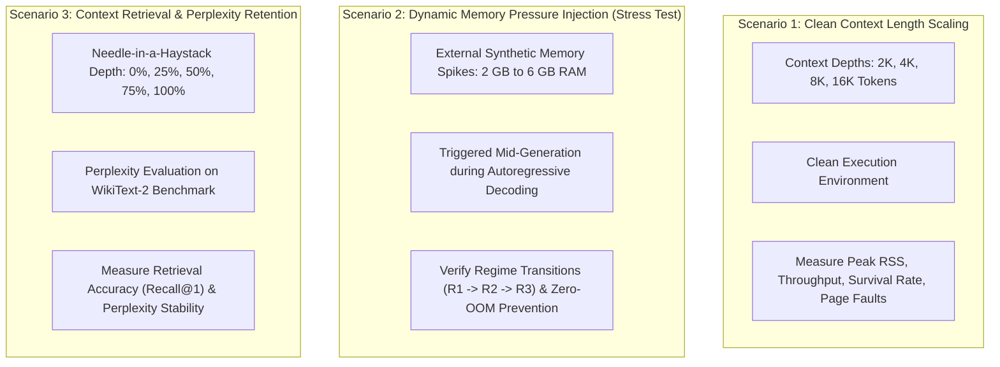

# Experimental Methodology and Evaluation

This document outlines the experimental procedures, empirical benchmark protocols, hardware testbed configurations, and quantitative metrics used to evaluate the **AMU-QUANT** runtime engine.

---

## 1. Hardware Testbed Specifications

To ensure reproducibility across representative consumer devices, empirical experiments are conducted on two distinct hardware configurations:

| Parameter | Node A (Primary 16 GB Target) | Node B (Constrained 8 GB Target) |
|:---|:---|:---|
| **Physical RAM** | 16 GB Unified Memory / LPDDR5 | 8 GB DDR4 / LPDDR4X |
| **Primary Storage** | NVMe PCIe 4.0 SSD (Read $\ge 4500\text{ MB/s}$) | NVMe PCIe 3.0 SSD (Read $\approx 2500\text{ MB/s}$) |
| **CPU Architecture** | Apple Silicon M-Series / Intel Core i7-13700H / AMD Ryzen 7 7840HS | Intel Core i5-1135G7 / Apple M1 |
| **SIMD Instruction Set** | ARM NEON / x86-64 AVX2 / AVX-512 | ARM NEON / x86-64 AVX2 |
| **Operating System** | macOS Sequoia (Darwin 24) / Ubuntu 24.04 LTS (Kernel 6.8) | Ubuntu 24.04 LTS / macOS Ventura |

---

## 2. Tested Model Spectrum (Cross-Scale Generalization)

AMU-QUANT is evaluated across a continuous spectrum of model scales to demonstrate architectural generalizability rather than specialization to a single parameter class:

1. **Compact Scale (Sub-3B):** `Qwen2.5-0.5B`, `Qwen2.5-1.5B`, and `Qwen2.5-3B` (Q4_K_M)
   * Evaluates extended context scaling (8K–32K tokens) on ultra-constrained edge devices (4 GB–8 GB RAM).
2. **Medium Scale (7B–8B):** `Meta-Llama-3-8B-Instruct` ($\approx 4.92\text{ GB}$) and `Qwen2.5-7B-Instruct`
   * Represents the critical transition threshold where weights fit in 16 GB RAM but saturate 8 GB RAM once KV-cache expands.
3. **Large Scale (14B–32B):** `Qwen2.5-14B-Instruct` ($\approx 8.99\text{ GB}$) and `Qwen2.5-32B-Instruct` / `DeepSeek-R1-Distill-Qwen-32B` ($\approx 19.8\text{ GB}$)
   * Model weights exceed physical RAM on both nodes, requiring seamless coordination between active weight prefetching and in-memory context compression.
4. **Very Large Scale (70B+ Exploratory):** `Meta-Llama-3-70B-Instruct` (Q2_K / Q4_K_M)
   * Tests extreme weight-to-RAM ratios under strict layer-by-layer streaming with full episodic context archival in `turbovec`.

---

## 3. Comparative Baseline Methods

AMU-QUANT is compared head-to-head against four representative paradigms:

| Identifier | Method Name | Implementation Description | Weight Paging & KV Behavior |
|:---:|:---|:---|:---|
| **B1** | **llama.cpp Default (mmap)** | Official `llama-cli` with standard `--mmap 1`. | Passive OS demand paging; full uncompressed FP16 KV-cache retained in RAM until OOM. |
| **B2** | **Pure Layer-Streaming** | Active layer eviction via `posix_madvise(DONTNEED)` without context compression. | Weights streamed per layer; uncompressed KV-cache expands unrestricted until OOM. |
| **B3** | **Naive Sliding Window (StreamingLLM-style)** | Preserves 4 attention sinks and most recent $N$ tokens, discarding middle tokens (*evict-to-trash*). | Static KV-cache clamp; discarded tokens are permanently lost; blind to host OS RAM. |
| **B4** | **Static KV Quantization (TurboQuant Fork)** | Static TurboQuant integration initialized homogeneously across all layers. | Fixed bit-width from start; non-adaptive to dynamic OS memory pressure or weight buffer contention. |
| **PROP** | **AMU-QUANT (Proposed)** | Closed-loop predictive controller ($\Phi_t$), active layer madvise, zero-copy evict-to-index to `turbovec` (4b $\to$ 2b), SIMD recall. | Dynamically balances layer prefetch depth and compressed context index based on kernel telemetry. |

---

## 4. Evaluation Scenarios

### 4.1 Scenario 1: Clean Context Scaling
Evaluates the scalability of each method across token horizons of 2048, 4096, 8192, and 16384 tokens in an isolated environment. Determines the exact saturation point where baseline approaches encounter OOM termination or swap thrashing.

### 4.2 Scenario 2: Dynamic Memory Pressure Injection
Simulates real-world multitasking by injecting external synthetic memory allocations (2 GB to 6 GB) during active token generation. Tests whether the controller detects accelerating pressure ($\frac{dM}{dt}$), downshifts prefetch depth, and triggers 2-bit in-place requantization before the OS kernel terminates the process.

### 4.3 Scenario 3: Context Retention & Perplexity
Tests factual memory preservation by embedding unique synthetic facts (*needles*) across variable document depth percentiles (0%, 25%, 50%, 75%, 100%) within 8K and 16K contexts. Evaluates exact-match retrieval accuracy (Recall@1) via SIMD cosine search compared to permanent context loss in B3. Measures language model perplexity (PPL) on the standard WikiText-2 benchmark.

---

## 5. Quantitative and Statistical Metrics

| Evaluation Category | Metric | Mathematical Definition / Formula | Measurement Instrumentation |
|:---|:---|:---|:---|
| **Memory Stability** | **Peak RSS (MB)** | Maximum physical memory footprint during run | `getrusage(RUSAGE_SELF).ru_maxrss` |
| | **Survival Rate (%)** | Fraction of runs completing without OOM termination | $\frac{\text{Completed Runs}}{\text{Total Runs}} \times 100\%$ |
| | **Context Compression Ratio** | Ratio of original FP16 KV size to compressed representation | $\frac{\text{Size}_{\text{FP16}}}{\text{Size}_{\text{turbovec}}}$ |
| **Execution Performance** | **Inter-Token Latency (ITL)** | Generation latency per decoded token | Nanosecond timestamp delta (`ms/tok`) |
| | **Throughput (tok/s)** | Sustained generation speed across active sequence | $\frac{\text{Generated Tokens}}{\text{Generation Time (s)}}$ |
| | **Major Page Faults** | Frequency of disk read faults caused by page eviction | `struct rusage::ru_majflt` |
| | **SIMD Search Latency** | Time required for Top-$K$ cosine similarity query | High-resolution CPU timer (`std::chrono` $\mu\text{s}$) |
| **Output Quality** | **Retrieval Accuracy (Recall@1)** | Exact-match rate on Needle-in-a-Haystack evaluations | $\frac{\text{Exact Matches}}{\text{Total Needle Queries}} \times 100\%$ |
| | **Perplexity (PPL)** | Exponentiated cross-entropy loss on benchmark text | WikiText-2 evaluation via standard test suite |

---

## 6. Academic Disclaimers and Accounting Methodology

To maintain absolute scientific transparency and prevent overclaiming in thesis and peer-reviewed evaluations, the following definitions and methodological boundaries govern all empirical results:

### 6.1 Physical Resident Set Size vs. Logical KV Capacity
* **Logical KV Capacity Reclaimed**: In `llama.cpp`, the attention buffer is allocated as a pre-dimensioned contiguous ring buffer arena upon context initialization. Calling `llama_memory_seq_rm()` invalidates sequence slots and repositions attention indices. This relieves attention computation complexity ($O(1)$ bounds) and prevents ring-buffer overflow, but does **not** issue immediate `munmap()` system calls to return raw pages to the operating system kernel.
* **Physical Process RSS**: Measured via `getrusage(RUSAGE_SELF).ru_maxrss` on Linux/macOS and verified via kernel task ports (`mach_task_basic_info`). Physical RSS reflects the actual physical memory pages mapped into the process's page table.

### 6.2 Decoupled Working Attention vs. Episodic Semantic Memory
* **Episodic Vector Indexing (`turbovec`)**: Tokens excised from the physical attention buffer have their token-level pooled embeddings archived into `turbovec` (Lloyd-Max 4-bit / 2-bit scalar quantization).
* **Scope Boundary**: Archived vectors serve as an associative semantic memory (in-process RAG) allowing the model or agent to recall historical facts with sub-millisecond SIMD search. This **does not** reconstruct the original intermediate 36-layer Key and Value tensor states. It trades lossless layer-wise attention for a 15.5x memory compression factor.

### 6.3 Layer Memory Advisory Semantics (`LayerManager`)
* **OS-Level Advisory Paging**: `LayerManager` utilizes `posix_madvise(..., POSIX_MADV_DONTNEED / WILLNEED)` to notify the OS Virtual Memory Manager (VMM) which pages of the mapped GGUF file are safe to drop under memory contention.
* **Scope Boundary**: Advisory paging communicates directly with the OS page cache; it does **not** rewrite GGML tensor execution graph ASTs at runtime. On unified memory systems, this provides OS memory relief while preserving process stability.

### 6.4 Measurement Protocols and Run-to-Run Variance
* **Hardware Variability**: Generation throughput on Apple Silicon Metal GPU naturally exhibits variance (+/- 1.5 tok/s) across runs depending on SoC thermal throttling, background OS daemon memory bus contention, and Metal shader pre-compilation state. All canonical benchmark tables document run configurations and recommend multi-trial averages for publication.
