# METODOLOGI DAN RENCANA EKSPERIMEN

Dokumen ini menguraikan prosedur pengujian, rancangan eksperimen empiris, konfigurasi perangkat uji, serta metodologi evaluasi performa sistem **AMU-QUANT**.

---

## 1. Konfigurasi Lingkungan Pengujian (Testbed Setup)

Pengujian empiris dilakukan pada dua konfigurasi perangkat keras yang merepresentasikan komputer jinjing (*laptop*) dan *workstation* pengguna akhir:

### 1.1 Spesifikasi Perangkat Keras
| Parameter Hardware | Node Pengujian A (Target Utama 16 GB) | Node Pengujian B (Target Ekstrem 8 GB) |
|:---|:---|:---|
| **Kapasitas RAM Fisik** | 16 GB Unified Memory / LPDDR5 | 8 GB DDR4 / LPDDR4X |
| **Penyimpanan Primer** | NVMe PCIe 4.0 SSD (Read $\ge 4500\text{ MB/s}$) | NVMe PCIe 3.0 SSD (Read $\approx 2500\text{ MB/s}$) |
| **Prosesor (CPU)** | Apple Silicon M-Series / Intel Core i7-13700H / AMD Ryzen 7 7840HS | Intel Core i5-1135G7 / Apple M1 |
| **Set Instruksi SIMD** | ARM NEON / AVX2 / AVX-512 | AVX2 / ARM NEON |
| **Sistem Operasi** | macOS Sequoia (Darwin 24) / Ubuntu 24.04 LTS (Kernel 6.8) | Ubuntu 24.04 LTS / macOS Ventura |

### 1.2 Model Bahasa yang Diuji (Spektrum Lintas Skala)
Seluruh model diperoleh dalam format **GGUF** (presisi kuantisasi bobot **Q4_K_M** dan **Q2_K**), mencakup spektrum parameter yang digeneralisasikan:

1. **Skala Kompak (Sub-3B):** `Qwen2.5-0.5B-Instruct`, `Qwen2.5-1.5B-Instruct`, dan `Qwen2.5-3B-Instruct`
   * Menguji ketahanan inferensi pada lingkungan perangkat dengan batas RAM sangat ketat (misal 4 GB–8 GB) saat konteks penalaran diperpanjang hingga batas maksimum (8K–32K token).
2. **Skala Menengah (7B–8B):** `Meta-Llama-3-8B-Instruct` (Ukuran file: $\approx 4{,}92\text{ GB}$) dan `Qwen2.5-7B-Instruct`
   * Berfungsi sebagai batas transisi di mana bobot model muat di RAM 16 GB namun menekan RAM 8 GB, dan dengan cepat memicu OOM saat KV-Cache membesar.
3. **Skala Besar (14B–32B):** `Qwen2.5-14B-Instruct` ($\approx 8{,}99\text{ GB}$) dan `Qwen2.5-32B-Instruct` / `DeepSeek-R1-Distill-Qwen-32B` ($\approx 19{,}8\text{ GB}$)
   * Model skala besar yang melampaui kapasitas RAM fisik dari node pengujian (8 GB maupun 16 GB), membuktikan peran koordinasi ko-adaptif antara streaming bobot aktif dan kompresi memori `turbovec`.
4. **Skala Sangat Besar (70B+ Eksploratif):** `Meta-Llama-3-70B-Instruct` (Q2_K / Q4_K_M)
   * Menguji batas ekstrem rasio kapasitas bobot terhadap RAM pada komputasi *layer-by-layer pure streaming* dengan pengarsipan konteks penuh di `turbovec`.

---

## 2. Metode Baseline Pembanding

Kinerja AMU-QUANT akan dikomparasi secara langsung terhadap empat pendekatan representatif:

| No | Nama Baseline | Deskripsi Implementasi | Karakteristik Streaming & KV |
|:---:|:---|:---|:---|
| **B1** | **llama.cpp Standar (Default mmap)** | Menggunakan binary `llama-cli` versi rilis stabil dengan flag `--mmap 1`. | Mengandalkan pelepasan halaman pasif oleh kernel OS; KV-cache disimpan utuh di RAM (FP16). |
| **B2** | **Layer-Streaming Murni (Tanpa turbovec)** | Mode streaming aktif yang melepas layer lewat `madvise(DONTNEED)` tanpa kompresi konteks. | Bobot dialirkan per layer, namun KV-cache tetap dibiarkan tumbuh utuh di RAM hingga OOM. |
| **B3** | **Sliding Window Naif (StreamingLLM-style)** | Mempertahankan 4 token awal (*attention sinks*) dan $N$ token terbaru, membuang token tengah permanen (*evict-to-trash*). | Bobot di-mmap, KV-cache dibatasi statis, informasi tengah hilang permanen. |
| **B4** | **Kuantisasi KV Statis (Static TurboQuant Fork)** | Menggunakan implementasi kompresi KV statis (misal kuantisasi 4-bit sejak awal generasi). | KV terkompresi sejak awal secara homogen, namun tidak ko-adaptif terhadap perebutan buffer bobot OS. |
| **PROP**| **AMU-QUANT (Usulan)** | Kontroler ko-adaptif dual-budget, streaming layer aktif via madvise, evict-to-index ke turbovec (4-bit $\to$ 2-bit), SIMD recall. | Menyeimbangkan alokasi buffer streaming dan indeks turbovec secara dinamis berdasarkan telemetri OS. |

---

## 3. Skenario Eksperimen

```mermaid
flowchart TD
    subgraph Skenario_1 ["Skenario 1: Skalabilitas Ukuran Model & Konteks"]
        S1_Input["Panjang Konteks: 2K, 4K, 8K, 16K"]
        S1_Test["Uji Bersih (Clean Environment)"]
        S1_Eval["Ukur Peak RSS, ITL, TTFT, Page Faults, Survival Rate"]
    end

    subgraph Skenario_2 ["Skenario 2: Dynamic OS Memory Pressure (Stress Test)"]
        S2_Input["Injeksi Beban Memori Sintetik (Alokasi 2 GB - 6 GB RAM)"]
        S2_Trigger["Dipicu di Tengah Generasi Autoregresif"]
        S2_Eval["Evaluasi Transisi Rejim (R1 -> R2 -> R3) & Pencegahan OOM"]
    end

    subgraph Skenario_3 ["Skenario 3: Ketahanan Akurasi Konteks (Needle-in-a-Haystack)"]
        S3_Input["Penyisipan Fakta Eksak pada Kedalaman 0%, 25%, 50%, 75%, 100%"]
        S3_Search["Pencarian Konteks Terkompresi via SIMD turbovec"]
        S3_Eval["Ukur Retrieval Recall@K & Perbedaan PPL terhadap Baseline"]
    end

    S1_Input --> S1_Test --> S1_Eval
    S2_Input --> S2_Trigger --> S2_Eval
    S3_Input --> S3_Search --> S3_Eval
```



### 3.1 Skenario 1: Skalabilitas Ukuran Model & Panjang Konteks (Clean Run)
* **Tujuan:** Mengetahui batas toleransi alokasi memori dan kurva degradasi performa (*degradation curve*) sistem ketika ukuran model dan panjang konteks ditingkatkan.
* **Prosedur:**
  1. Perangkat di-*restart* ke kondisi bersih (*fresh boot*); aplikasi pihak ketiga ditutup.
  2. Model dieksekusi untuk menghasilkan teks dengan variasi panjang konteks: $2048$ (2K), $4096$ (4K), $8192$ (8K), dan $16384$ (16K) token.
  3. Setiap pengujian diulang sebanyak 5 kali (*5 independent runs*) untuk menjamin konsistensi statistik.

### 3.2 Skenario 2: Dynamic OS Memory Pressure Injection (Stress Test)
* **Tujuan:** Menguji sensitivitas kontroler AMU-QUANT dan keandalan rejim adaptasi (khususnya transisi ke Regime 3: *Ultra-Low Survival Mode*) saat terjadi lonjakan konsumsi memori tak terduga dari aplikasi eksternal.
* **Prosedur:**
  1. Inferensi model 14B atau 32B dimulai pada panjang konteks 8K token.
  2. Pada langkah pembuatan token ke-500, skrip injeksi latar belakang (*memory stressor utility*) secara mendadak mengalokasikan memori anonim sebesar $4\text{ GB}$ (pada node 16 GB) atau $2\text{ GB}$ (pada node 8 GB) dan menahannya selama 30 detik.
  3. Diamati apakah terjadi terminasi OOM, bagaimana laju perubahan Skor $\Phi_t$, serta berapa lama sistem melakukan transisi rejim dan rekuantisasi 2-bit *in-place*.

### 3.3 Skenario 3: Evaluasi Ketahanan Konteks (Needle-in-a-Haystack & PPL)
* **Tujuan:** Membuktikan bahwa paradigma *evict-to-index* pada AMU-QUANT mampu menjaga kemampuan model dalam mengingat informasi masa lalu, berbeda dari pendekatan pemangkasan *evict-to-trash* (StreamingLLM / H2O) yang kehilangan informasi selamanya.
* **Prosedur:**
  1. Menyiapkan teks latar belakang berupa dokumen panjang (kumpulan artikel Paul Graham atau dokumen teknis Wikipedia) sepanjang 8K dan 16K token.
  2. Menyisipkan "jarum" fakta unik (contoh: *"Kunci rahasia brankas laboratorium adalah 948291"*) pada posisi kedalaman 0% (awal), 25%, 50%, 75%, dan 100% (akhir konteks).
  3. Meminta model menjawab pertanyaan spesifik mengenai kunci rahasia tersebut.
  4. Menghitung persentase keberhasilan ekstraksi fakta (*Exact Match Recall*).
  5. Menghitung nilai Perplexity (PPL) pada teks benchmark standar WikiText-2.

---

## 4. Parameter & Metrik Pengukuran Kuantitatif

Setiap uji coba dicatat secara otomatis menggunakan instrumentasi telemetri tingkat rendah:

### 4.1 Metrik Stabilitas & Konsumsi Sumber Daya
1. **Peak Resident Set Size (Peak RSS):**  
   Nilai puncak pemakaian memori fisik proses (dalam Megabyte/Gigabyte) yang diperoleh melalui pembacaan `getrusage(RUSAGE_SELF, ...)` pada kolom `ru_maxrss` di Unix/macOS atau parsing file `/proc/[pid]/status` (`VmHWM`).
2. **Survival Rate (%):**  
   Rasio tugas inferensi yang selesai hingga token akhir (*EOS*) tanpa mengalami terminasi akibat sinyal `SIGKILL` dari OS OOM Killer:
   $$\text{Survival Rate} = \frac{N_{\text{sukses}}}{N_{\text{total\_percobaan}}} \times 100\%$$
3. **Major Page Faults Rate ($\Delta \text{majflt} / \text{token}$):**  
   Frekuensi pembacaan halaman memori yang terpaksa mengambil data dari blok penyimpanan SSD karena halaman tersebut belum atau tidak lagi berada di RAM fisik (`ru_majflt`).

### 4.2 Metrik Performa Inferensi
1. **Inter-Token Latency (ITL):**  
   Waktu yang dibutuhkan untuk menghasilkan satu token baru pada fase decoding autoregresif (dinyatakan dalam milidetik/token).
2. **Time-to-First-Token (TTFT):**  
   Waktu pemrosesan awal (*prompt evaluation phase*) hingga token pertama berhasil dikeluarkan ke pengguna (dalam detik).
3. **FFI and Search Overhead:**  
   Waktu komputasi yang dihabiskan untuk melewati batas FFI C-ABI dan menjalankan pencarian SIMD di dalam indeks `turbovec` (dalam mikrodetik).

### 4.3 Metrik Kualitas Bahasa
1. **Retrieval Recall@K:**  
   Tingkat keberhasilan menemukan token atau blok fakta yang tepat dari indeks `turbovec` saat kueri diarahkan pada fakta yang telah dipangkas.
2. **Perplexity (PPL):**  
   Tingkat kebingungan probabilitas model terhadap distribusi token:
   $$\text{PPL} = \exp\left( - \frac{1}{N} \sum_{i=1}^N \log P(w_i \mid w_{<i}) \right)$$

---

## 5. Rencana Pipeline Eksekusi Otomatis (Automation Runner)

Untuk menjamin reprodusibilitas hasil eksperimen (*reproducibility*), pengujian dikendalikan oleh skrip otomasi terpadu:

```
scripts/
├── benchmark_runner.py          # Orkestrator pengujian lintas parameter & model
├── memory_stressor.c           # Utilitas injeksi beban RAM sintetik (malloc & memset)
├── parse_metrics.py            # Parser log telemetri, getrusage, dan kalkulasi statistik
└── plot_results.py             # Generator grafik komparasi (Peak RSS, ITL, Page Faults)
```
