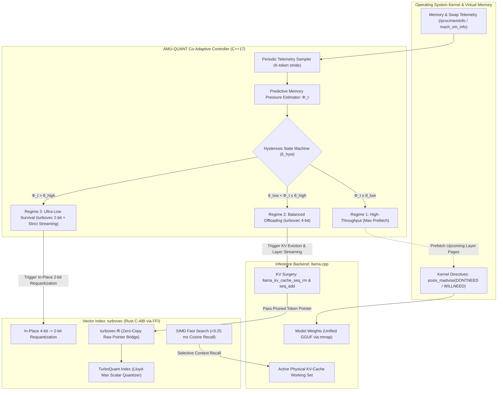

# AMU-QUANT Technical Documentation

This directory contains the scientific specifications, mathematical formulations, subsystem architecture, foreign function interface (FFI) contracts, and experimental evaluation methodology for **AMU-QUANT** (*Co-Adaptive Layer-wise Weight Streaming and TurboQuant Context Compression for On-Device Large Language Model Inference*).

---

## 1. Documentation Index

| Index | Document | Summary |
|:---:|:---|:---|
| **01** | [**System Architecture**](01_SYSTEM_ARCHITECTURE.md) | High-level subsystem layout (Layer Manager, KV Surgery, FFI Bridge, Controller), zero-copy pointer flows, and thread-safety invariants. |
| **02** | [**Mathematical Model & Controller**](02_MATHEMATICAL_MODEL_AND_CONTROLLER.md) | Dual-budget memory equilibrium inequality, predictive pressure metric $\Phi_t$, hysteresis state machine, and scheduling algorithm. |
| **03** | [**turbovec FFI Specification**](03_TURBOVEC_FFI_SPECIFICATION.md) | C-ABI interface header `turbovec_ffi.h`, Rust bridge implementation, Lloyd-Max codebooks, in-place 2-bit requantization, and SIMD vectorization. |
| **04** | [**Experimental Methodology**](04_EXPERIMENTAL_METHODOLOGY.md) | Hardware testbeds (8 GB and 16 GB nodes), cross-scale model spectrum (sub-3B, 7B/8B, 14B/32B, 70B+), 4 baseline methods, 3 stress-testing scenarios, and metrics. |
| **05** | [**Literature Review & References**](05_LITERATURE_REVIEW_AND_REFERENCES.md) | Critical analysis of AirLLM, llama.cpp mmap, evict-to-trash pruning (StreamingLLM, H2O, ThinKV, Lethe), Data Science & NLP theoretical foundations, and verified citations. |

---

## 2. Co-Adaptive Execution Lifecycle



---

## 3. Directory Layout

```text
docs/
├── README.md                                 # Technical documentation index
├── 01_SYSTEM_ARCHITECTURE.md                 # Subsystem design & execution flow
├── 02_MATHEMATICAL_MODEL_AND_CONTROLLER.md   # Formal equilibrium & predictive metric
├── 03_TURBOVEC_FFI_SPECIFICATION.md          # C-ABI header & Rust FFI implementation
├── 04_EXPERIMENTAL_METHODOLOGY.md            # Benchmark protocols, hardware, & metrics
└── 05_LITERATURE_REVIEW_AND_REFERENCES.md    # Critical analysis, Data Science & citations
```
