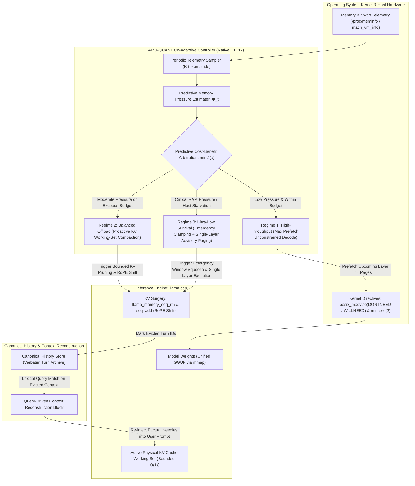

# AMU-QUANT Technical Documentation

This directory contains the scientific specifications, mathematical formulations, subsystem architecture, and experimental evaluation methodology for **AMU-QUANT** (*Host-Aware Co-Adaptive Runtime Memory Policy and Sliding-Window KV-Cache Surgery for Edge Large Language Model Inference*).

---

## 1. Documentation Index

| Index | Document | Summary |
|:---:|:---|:---|
| **01** | [**System Architecture**](01_SYSTEM_ARCHITECTURE.md) | High-level native C++17 subsystem layout (Telemetry, Layer Manager, KV Surgeon, Controller, Canonical History & FactRegister), memory boundaries, and thread-safety invariants. |
| **02** | [**Mathematical Model & Controller**](02_MATHEMATICAL_MODEL_AND_CONTROLLER.md) | Dual-budget memory equilibrium inequality, predictive pressure metric $\Phi_t$, cost-benefit utility $J(a)$, temporal conflict state space, evidence threshold $\tau_{\text{evidence}}$, and scheduling algorithm. |
| **04** | [**Experimental Methodology**](04_EXPERIMENTAL_METHODOLOGY.md) | Hardware testbeds, empirical benchmarks (Triad Benchmark & Scenario 4 Tri-Dimensional Reliability Benchmark inspired by HaluMem), host memory starvation protocols, and metrics. |
| **05** | [**Literature Review & References**](05_LITERATURE_REVIEW_AND_REFERENCES.md) | Critical comparative analysis against AirLLM, llama.cpp mmap, attention sinking (StreamingLLM, H2O, ThinKV), reliable local memory architectures (HaluMem), computer systems memory modeling, and verified academic references. |

---

## 2. Co-Adaptive Execution Lifecycle



---

## 3. Directory Layout

```text
docs/
├── README.md                                 # Technical documentation index
├── 01_SYSTEM_ARCHITECTURE.md                 # Subsystem design & execution flow
├── 02_MATHEMATICAL_MODEL_AND_CONTROLLER.md   # Formal equilibrium & predictive metric
├── 04_EXPERIMENTAL_METHODOLOGY.md            # Benchmark protocols, hardware, & metrics
└── 05_LITERATURE_REVIEW_AND_REFERENCES.md    # Critical analysis & citations
```
